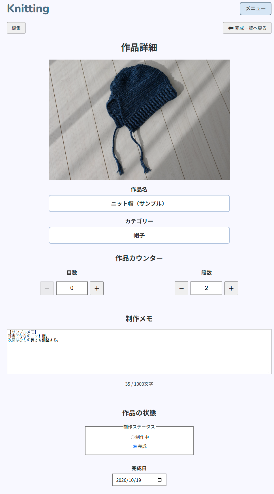

# Knitting

編み物に必要な計算と作品の制作記録を支援するWebアプリケーションです。

編み図と異なる毛糸を使用する際の目数・段数の調整や、2本取り・引き揃えの計算ができます。
また、編み途中の目数・段数のカウントや、作品ごとの制作状況・メモの記録にも対応しています。

## 開発背景・解決したい課題

編み物では、使用する毛糸に合わせた目数・段数の調整や、2本取り・引き揃えの計算、
制作中の目数・段数のカウント、作品ごとの進捗やメモの記録など、さまざまな作業が必要です。

これらの機能を個別に提供するツールはあるものの、自分が調べた範囲では、
必要な機能を一つにまとめて利用できるアプリが見つかりませんでした。

そこで、編み物を楽しむ人が計算から制作記録までを一つのアプリで
手軽に行えるようにすることを目的として、Knittingを開発しました。

## 主な機能

- **ゲージ・目数・段数調整**  
  編み図と使用する毛糸のゲージの違いから、必要な目数・段数を計算できます。

- **2本取り・引き揃え計算**  
  毛糸の重量と長さから、組み合わせ後の毛糸の太さや推奨針号数の目安を確認できます。

- **簡易カウンター・毛糸対応表**  
  目数・段数のカウントや、毛糸の太さと推奨針号数の確認ができます。

- **作品管理**  
  作品の登録・編集・削除、制作状況や完成日の管理、作品ごとの目数・段数のカウント、制作メモの記録ができます。

計算機能・簡易カウンター・毛糸対応表はログイン不要で利用でき、作品管理はログイン後に利用できます。

### 画面イメージ

## 工夫した点

### 1. ログイン不要で利用できる機能

気軽に利用できるよう、計算機能・簡易カウンター・毛糸対応表はユーザー登録なしで使えるようにしました。
一方、作品管理はユーザー登録制とし、作品ごとの記録を継続して保存できる仕組みにしています。

### 2. 操作の手間を減らす自動保存

編み物中に保存操作を繰り返す必要がないよう、作品ごとのカウンターや制作メモに自動保存機能を実装しました。
通信エラーが発生した場合も入力内容を保持し、手動で再試行できるようにしています。

### 3. ユーザーごとの作品データの保護

複数のユーザーが安全に作品を管理できるよう、Spring Securityを使用した認証・アクセス制御を実装しました。
また、作品の取得や更新時に所有者を確認し、他のユーザーの作品を閲覧・変更・削除できない仕組みにしています。

## 使用技術

| 分類 | 技術 |
|---|---|
| バックエンド | Java 25 / Spring Boot 4.0.8 / Spring MVC |
| フロントエンド | HTML / CSS / JavaScript / Thymeleaf |
| データベース | MySQL 8.4 LTS |
| データアクセス・DB管理 | Spring Data JPA / Hibernate / Flyway |
| 認証・認可 | Spring Security |
| 開発・ビルド | Eclipse / Maven / Git / GitHub |

## 動作確認

ローカル環境で動作確認済みです。ソースコードはGitHubのプライベートリポジトリで管理しており、
一般公開を準備中です。Webアプリケーションの公開環境は未構築です。

- **実行環境：** JDK 25 / MySQL 8.4 LTS / Eclipse
- **環境設定：** DB_URL、DB_USERNAME、DB_PASSWORD、REMEMBER_ME_KEYの設定が必要
- **テスト結果：** Mavenによる自動テスト295件成功（2026年10月19日時点）

## 設計資料

詳しい仕様や設計内容は、以下の資料にまとめています。

- [要件定義書](docs/01_requirements.md)
- [基本設計書](docs/02_basic-design.md)
- [画面設計書](docs/03_screen-design.md)
- [データベース設計書](docs/04_database-design.md)
- [詳細設計書](docs/05_detailed-design.md)

## AIの活用について

本アプリの開発では、ChatGPTを要件定義から実装・テスト・ドキュメント作成まで幅広く活用しました。

| 工程 | 担当 | 主な作業・AI活用内容 |
|---|---|---|
| テーマ・課題発見 | 自分 | 編み物で感じた課題から開発テーマを決定 |
| 要件定義 | 自分＋AI | 機能案の提案、要件の整理 |
| 設計 | 自分＋AI | 設計案の作成、設計書の作成・レビュー |
| 実装 | AI中心＋自分 | コード生成、修正案の作成 |
| エラー調査・修正 | 自分＋AI | 原因調査、修正方法の提案 |
| テスト | 自分＋AI | テスト項目・テストコードの作成支援 |
| ドキュメント | 自分＋AI | README・設計書の作成・更新支援 |
| 動作確認・最終判断 | 自分 | ブラウザでの動作確認、テスト実行、仕様や修正内容の採否判断 |

AIが生成したコードや提案を開発環境に反映し、動作確認やテストを繰り返しながら開発を進めました。
機能や仕様の最終的な判断は自分で行い、AIを開発支援ツールとして活用しています。
