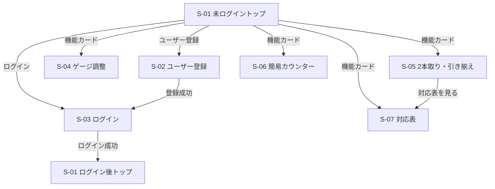
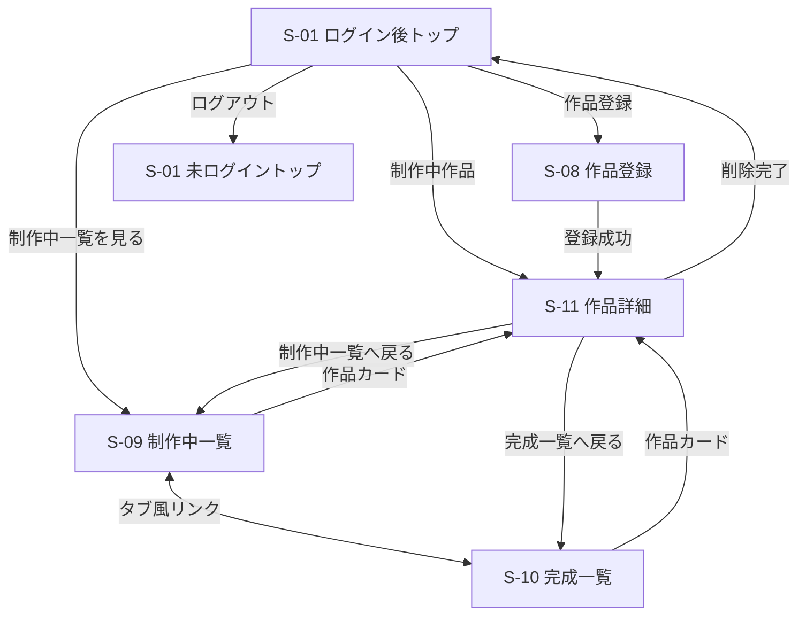

# Knitting 画面設計書

## 文書情報

| 項目 | 内容 |
| --- | --- |
| 対象システム | Knitting |
| 文書種別 | 画面設計書 |
| 作成日 | 2026年9月6日 |
| 文書状態 | 最新画面仕様検討書・データベース設計書反映済み・今後更新予定 |
| 実装状況 | 本書に記載する画面・機能はすべて未実装 |
| 参照資料 | README.md、01_requirements.md、02_basic-design.md、04_database-design.md、S-01～S-11画面仕様検討書、共通デザイン・共通ナビゲーション仕様 |

> [!NOTE]
> 本書では、各画面固有の仕様はS-01～S-11の最新版、全画面共通の仕様は「共通デザイン・共通ナビゲーション仕様」を優先しています。S-11は「作品詳細画面_差し替え版」を使用しています。資料にない実装方式・URL・色・寸法等は決定していません。

## 1. 本書の目的

本書は、要件定義書で定めた機能要件と、基本設計書で定めたユーザーから見た動作・画面構成を、実装時に参照できる画面単位の仕様へ具体化するものです。

各画面の利用条件、表示内容、入力項目、操作、画面遷移、状態保持、バリデーション、レスポンシブ表示を整理し、Spring Bootによる実装とGitHub上での設計説明に使用します。Javaクラス、URL、データベース構造、HTML・CSS・JavaScriptの具体的な実装方式は本書の対象外です。

## 2. 画面設計の基本方針

### 2.1 ログイン状態による違い

| 状態 | 基本方針 |
| --- | --- |
| 未ログイン | S-01～S-07の公開画面を利用できる。ログイン後用ハンバーガーメニューは表示しない |
| ログイン後 | 公開画面に加えて、本人の作品に関するS-08～S-11を利用できる |
| 未ログインでログイン必須画面へアクセス | S-03へ移動し、「この機能を利用するにはログインしてください。」と表示する |
| 他ユーザーの作品 | 閲覧・変更・削除できないようにする。具体的なアクセス制御方法は詳細設計・実装時に決定する |

### 2.2 レイアウトとレスポンシブ

- PC・スマートフォンの両方で利用できる構成とする。
- PCでは、対になる情報やカードを複数列で表示する。各画面で定めた列数を使用する。
- スマートフォンでは原則として縦1列へ切り替える。
- 具体的なブレークポイント、最大幅、余白、各要素の寸法は未定とし、詳細デザイン・実装時に決定する。
- ログイン後はPC・スマートフォンともに同じハンバーガーメニュー方式を使用する。

### 2.3 ロゴ・カード・主要操作

- ヘッダー左側に文字ロゴ「Knitting」を表示する。専用画像ロゴは必須としない。
- トップの機能カード、トップの作品カード、作品一覧カードは、カード全体をクリック／タップ可能にする。
- カードでは主情報と補助情報に優先順位を付ける。作品名を主情報、目数・段数または完成日を補助情報として扱う。
- 主要ボタンと、戻るリンク等の補助操作は視覚的に区別する。
- 操作できないボタンは、無効であることが見た目でも分かるようにする。
- アイコンは必須としない。統一して利用できる適切なものがある場合のみ、実装時に採用を検討する。

### 2.4 入力フォームとエラー

- 入力フォームは原則として「ラベル → 入力欄 → 補助説明またはエラー」の順で縦に配置する。
- 入力前に必要な文字数・形式等を把握できるよう、確定している入力条件を入力欄付近に表示する。
- 項目を特定できるエラーは該当入力欄の直下または付近へ表示する。
- 認証失敗等、特定項目に原因を結び付けないエラーはフォーム共通の位置へ表示する。
- 案内・成功メッセージとエラーメッセージは、役割が分かるように視覚的に区別する。
- 入力条件を満たさない間は、登録・ログイン・計算等の主要ボタンを無効にする画面がある。対象条件は各画面の設計に従う。
- パスワードの表示／非表示は、S-02とS-03で同じ位置・同じ操作方法に統一する。

### 2.5 確認操作

確認を表示する操作は次のとおりです。

| 操作 | 確認の扱い |
| --- | --- |
| 簡易カウンターの個別リセット | 確認なし |
| 簡易カウンターのすべてリセット | 実行前に確認する |
| 制作ステータス変更 | 確認なし |
| 未保存の作品基本情報を残した画面移動 | 未保存警告を表示する |
| ログアウト | 実行前に確認する |
| 未保存状態でのログアウト | 未保存警告を含む1つのログアウト確認を表示する |
| 作品削除 | 関連情報も削除され、復元できないことを確認する |

確認画面またはダイアログの具体的な表示方式・配色・寸法は未定です。

### 2.6 初期画像

- 作品写真が登録されていない場合は、Knittingで用意する共通の初期画像を表示する。
- S-08では初期画像を最初からプレビューし、写真を選択した場合は選択画像へ更新する。
- S-11で写真を削除した場合は初期画像へ戻す。
- 初期版では登録画像の実ファイルをローカルへ保存し、MySQLには参照情報を保持する。具体的な保存ディレクトリ、ファイル名、形式、容量、圧縮・削除処理等は後工程で決定する。
- 初期画像の具体的な素材・デザインは実装時までに決定する。

### 2.7 保存とデータ保持

| 対象 | 保存・保持方式 |
| --- | --- |
| S-11の作品名・作品写真・カテゴリー | 編集モードで変更し、「保存」で確定する。「キャンセル」で破棄する |
| S-11の目数・段数 | 変更時に作品ごとに自動保存する |
| S-11の制作メモ | 保存ボタンを設けず自動保存する |
| S-11の制作ステータス・完成日 | 変更時に自動保存する |
| S-06の目数・段数 | 保存ボタンを設けず自動保持し、ページ移動後・ブラウザ終了後も再開できるようにする |

- S-11の自動保存済み項目については、画面移動時の未保存警告を表示しない。
- S-11の作品基本情報を編集中で未保存の場合のみ、画面移動前に確認する。
- S-06の保持方法と、S-11の自動保存方法・通信方式は詳細設計・実装時に決定する。
- 自動保存失敗時の表示・再試行方法は後工程で決定する。

### 2.8 フッター

初期実装では、全画面のフッターに「© Knitting」を表示します。具体的な位置、余白、文字サイズ等は詳細デザイン時に決定します。

## 3. 共通ナビゲーション設計

### 3.1 未ログイン時

| 項目 | 仕様 |
| --- | --- |
| ヘッダー左側 | 文字ロゴ「Knitting」 |
| 未ログイントップ右側 | 「ログイン」「ユーザー登録」 |
| ユーザー登録画面右側 | 「ログイン」。現在画面の「ユーザー登録」は重複表示しない |
| ログイン画面右側 | 「ユーザー登録」。現在画面の「ログイン」は重複表示しない |
| その他の公開画面右側 | 「ログイン」「ユーザー登録」 |
| ハンバーガーメニュー | 使用しない |
| 公開画面の戻る操作 | 「トップへ戻る」から未ログイントップへ移動する |
| フッター | 「© Knitting」 |

### 3.2 ログイン後

ログイン後は、PC・スマートフォンとも、ヘッダー左側に文字ロゴ「Knitting」、右側にハンバーガーメニューボタンを表示します。

#### メニュー構成

| 区分 | 項目 |
| --- | --- |
| トップ | トップ |
| 作品 | 作品を登録、制作中一覧、完成一覧 |
| 計算 | ゲージ・目数・段数調整、2本取り・引き揃え計算、簡易カウンター |
| 参考 | 毛糸・推奨針号数対応表 |
| アカウント操作 | ログアウト |

- 「作品」「計算」「参考」はメニュー内容を整理する区分です。
- 主要項目を一度に確認できる構成とし、何段階も展開するサブメニューにはしません。
- 各項目を選択すると、対象画面へ通常のページ遷移を行い、遷移後はメニューを閉じます。
- ログアウトは区切り線または十分な間隔を設けて最下部へ配置します。
- メニュー項目と並び順は、ログイン後の全画面で原則として共通とします。

#### 現在地表示

- 現在地は、ページ上部のページ名・見出しを主な手段として示します。
- メニュー内では、対応する1項目へ「▶」を付け、薄い背景色や文字の強調で補助表示します。
- S-11では専用メニューを追加せず、制作中作品なら「▶ 制作中一覧」、完成作品なら「▶ 完成一覧」を表示します。
- S-11で制作ステータスを変更した場合は、変更後のステータスに合わせて現在地強調と一覧への戻り先を切り替えます。

#### ログアウト

- ログアウトを選択すると、「ログアウトしますか？」という趣旨の確認を表示します。
- 確認では「キャンセル」と「ログアウト」を選択できます。
- 未保存の作品基本情報がある場合は、「保存されていない変更内容は失われます」という趣旨を同じ確認内へ含めます。
- ログアウト後は未ログイントップへ移動します。

#### PC・スマートフォン

- どちらもハンバーガーメニューを使用し、項目・操作ルールを変えません。
- メニューが画面高に収まらない場合は、必要に応じてメニュー領域をスクロール可能にします。
- ドロワー／ポップオーバー等の形式、幅、表示方向、背景、アニメーションは詳細デザイン時に決定します。

## 4. 画面一覧

| 画面ID | 画面名 | 利用条件 | 主な役割 |
| --- | --- | --- | --- |
| S-01 | トップ画面 | 共通 | 公開機能への入口。ログイン後は制作中作品も表示する |
| S-02 | ユーザー登録画面 | 未ログイン | 新しいユーザーアカウントを登録する |
| S-03 | ログイン画面 | 未ログイン | ログイン、自動ログイン選択、案内・認証エラーを表示する |
| S-04 | ゲージ・目数・段数調整画面 | 共通 | 指定ゲージと実測ゲージから調整後の目数・段数を計算する |
| S-05 | 2本取り・引き揃え計算画面 | 共通 | 2本使用時の換算糸長、毛糸の太さ、推奨針号数を計算する |
| S-06 | 簡易カウンター画面 | 共通 | 作品と紐づかない目数・段数を保持する |
| S-07 | 毛糸・推奨針号数対応表画面 | 共通 | 毛糸の太さ、長さ、推奨針の対応を一覧表示する |
| S-08 | 作品登録画面 | ログイン後 | 作品基本情報と初期ステータスを登録する |
| S-09 | 制作中一覧画面 | ログイン後 | 本人の制作中作品を一覧表示する |
| S-10 | 完成一覧画面 | ログイン後 | 本人の完成作品を一覧表示する |
| S-11 | 作品詳細画面 | ログイン後 | 作品情報、カウンター、メモ、状態、完成日、削除を管理する |

初期実装では計算機能一覧画面および共通エラー画面を設けません。404、存在しない作品、予期しないシステムエラー等の画面・処理は後工程で検討します。

## 5. 画面遷移

### 5.1 未ログイン・公開機能

S-02～S-07の「トップへ戻る」は、未ログイン時にはS-01未ログイントップ、ログイン後の公開画面ではS-01ログイン後トップへ移動します。未ログインでS-08～S-11等へアクセスした場合は、案内付きのS-03へ移動します。

### 5.2 ログイン後の作品管理

ログイン後共通ナビゲーションからは、S-01、S-04～S-10へ移動できます。S-11は一覧またはトップの作品カード、S-08の登録成功後から表示します。

## 6. 各画面設計

### 6.1 S-01 トップ画面

#### 基本情報

| 項目 | 内容 |
| --- | --- |
| 画面ID | S-01 |
| 画面名 | トップ画面 |
| 利用条件 | 未ログイン／ログイン後 |
| 目的・役割 | 未ログイン時は公開機能と認証への入口、ログイン後は制作中作品と公開機能への入口を提供する |

#### 画面構成・表示項目

| 領域 | 未ログイン | ログイン後 |
| --- | --- | --- |
| ヘッダー | 文字ロゴ／ログイン／ユーザー登録。ハンバーガーなし | 文字ロゴ／ハンバーガーメニュー。「▶ トップ」を現在地表示 |
| ページ上部 | キャッチコピーと、公開機能・ユーザー登録に関する短い案内 | 制作中作品を主要コンテンツとして表示 |
| 作品領域 | 表示しない | 最終更新日時が新しい順の最新4件 |
| 公開機能 | 4つの機能カード | 制作中作品の下に同じ4つの機能カード |
| 登録案内 | 公開機能の下にユーザー登録案内を表示 | 「制作中の作品」見出し付近に「＋ 作品を登録」を表示 |
| フッター | © Knitting | © Knitting |

公開機能カードの順序は次のとおりです。

1. ゲージ・目数・段数調整
2. 2本取り・引き揃え計算
3. 簡易カウンター
4. 毛糸・推奨針号数対応表

- 機能カードは機能名を主表示とし、説明文は原則として表示しません。
- トップ用作品カードは、作品写真、作品名、補助情報として「目数 ○・段数 ○」を表示します。
- 写真未登録時は初期画像を表示します。
- 完成作品はトップへ表示せず、S-10で確認します。

#### ボタン・リンク・操作

| 表示・操作 | 条件 | 動作・遷移先 | 確認 |
| --- | --- | --- | --- |
| ログイン | 未ログイン | S-03 | なし |
| ユーザー登録 | 未ログイン | S-02 | なし |
| 公開機能カード | 共通 | 選択したS-04～S-07 | なし |
| ユーザー登録ボタン | 未ログイン | S-02 | なし |
| ログイン導線 | 未ログイン | S-03 | なし |
| 作品カード | ログイン後 | 対象作品のS-11 | なし |
| ＋ 作品を登録 | ログイン後 | S-08 | なし |
| 制作中一覧を見る | ログイン後 | S-09 | なし |

#### 状態・レスポンシブ

- ログイン後の制作中作品は最終更新日時が新しい順の先頭4件とします。
- PCでは、制作中作品を2列×2行、公開機能カードを2列で表示します。
- スマートフォンでは、作品カード・機能カードとも縦1列で表示します。

#### 未確定事項

- キャッチコピーは「編み物の計算と記録を、もっとかんたんに。」を第一候補とし、最終文言は未確定です。
- 具体的な色、余白、カード寸法、フォントサイズ、アイコンは詳細デザイン・実装時に決定します。
- ログイン後トップで制作中作品が0件の場合の専用表示は、資料上で未定です。

### 6.2 S-02 ユーザー登録画面

#### 基本情報

| 項目 | 内容 |
| --- | --- |
| 画面ID | S-02 |
| 画面名 | ユーザー登録画面 |
| 利用条件 | 未ログイン |
| 目的・役割 | 登録条件を示し、新しいユーザーアカウントを登録する |

#### 画面構成

- ヘッダー左側に文字ロゴ、右側に「ログイン」を表示します。ハンバーガーメニューと「ユーザー登録」の重複表示は行いません。
- メイン領域は「ユーザー登録」見出し、入力フォーム、注意書き、主要ボタン、「トップへ戻る」の順を基本とします。
- フッターに「© Knitting」を表示します。
- PC・スマートフォンとも入力項目を縦方向へ配置します。

#### 入力・選択項目

| 項目 | 必須／任意 | 入力形式・条件 | 初期値 | 補足 |
| --- | --- | --- | --- | --- |
| メールアドレス | 必須 | メールアドレス形式。登録済みメールアドレスと重複不可 | 未定 | エラーは入力欄直下 |
| ユーザー名 | 必須 | 4～20文字の半角英数字。登録済みユーザー名と重複不可 | 未定 | 重複判定・ログイン時は大文字・小文字を区別しない |
| パスワード | 必須 | 8～64文字。特定文字種を必須としない | 未定 | 表示／非表示切替あり |
| パスワード（確認） | 必須 | パスワードと一致 | 未定 | 表示／非表示切替あり |

ユーザー名は登録時の表記を表示用として保持してよいものとします。大文字・小文字を区別しないための正規化・保存・検索方法は詳細設計・実装時に決定します。

#### ボタン・リンク・操作

| 表示名 | 実行条件 | 動作・遷移先 | 確認 |
| --- | --- | --- | --- |
| ユーザー登録 | 全入力が正常 | 登録し、成功後にS-03へ移動 | なし |
| パスワード表示切替 | 対象欄表示中 | 入力内容の表示／非表示を切り替える | なし |
| ログイン | 常時 | S-03 | なし |
| トップへ戻る | 常時 | S-01未ログイントップ | なし |

初期版ではパスワード再設定機能を設けません。登録ボタン付近に「※初期版ではパスワード再設定機能には対応していません。」を基本候補とする注意書きを表示します。

#### バリデーション・エラー表示

- 入力条件は各入力欄付近へ常時表示します。
- 未入力、形式・文字数違反、重複、パスワード不一致がある間は登録ボタンを無効にします。
- エラーは対象入力欄の直下へ具体的に表示します。
- メッセージ例は「正しいメールアドレス形式で入力してください。」「このメールアドレスはすでに登録されています。」「4～20文字の半角英数字で入力してください。」「このユーザー名はすでに使用されています。」「8～64文字で入力してください。」「パスワードが一致しません。」です。

#### 状態・画面遷移

- 登録成功後は自動ログインしません。
- 登録完了専用画面は作成せず、S-03へ移動して登録完了の案内を表示します。
- 主な遷移元はS-01、S-03です。

#### 未確定事項

- 入力欄・ボタンの寸法、余白、色、フォントサイズ。
- パスワード表示切替の具体的なアイコンと実装方法。
- メールアドレス・ユーザー名の重複確認タイミングと通信方法。

### 6.3 S-03 ログイン画面

#### 基本情報

| 項目 | 内容 |
| --- | --- |
| 画面ID | S-03 |
| 画面名 | ログイン画面 |
| 利用条件 | 未ログイン |
| 目的・役割 | ユーザー名・パスワードで認証し、必要に応じて案内を表示する |

#### 画面構成

- ヘッダー左側に文字ロゴ、右側に「ユーザー登録」を表示します。ハンバーガーメニューと「ログイン」の重複表示は行いません。
- メイン領域は、必要な場合だけ表示する案内領域、「ログイン」見出し、入力フォーム、自動ログイン、主要ボタン、補助導線の順を基本とします。
- フッターに「© Knitting」を表示します。
- S-02とフォームの基本デザインを統一します。

#### 入力・選択項目

| 項目 | 必須／任意 | 入力形式・条件 | 初期値 | 補足 |
| --- | --- | --- | --- | --- |
| ユーザー名 | 必須 | 登録済みユーザー名。大文字・小文字を区別しない | 未定 | 未入力時は項目エラー |
| パスワード | 必須 | 登録済みパスワード | 未定 | 表示／非表示切替あり |
| 30日間ログイン状態を保持する | 任意 | チェックボックス | OFF | ONの場合は30日間保持 |

#### 案内・エラー

| 条件 | 種別 | 表示内容 |
| --- | --- | --- |
| 通常アクセス | なし | 案内なし |
| S-02で登録成功後 | 成功・案内 | 「ユーザー登録が完了しました。ログインしてください。」という趣旨 |
| 未ログインでログイン必須画面へアクセス | 案内 | 「この機能を利用するにはログインしてください。」 |
| ユーザー名未入力 | 項目エラー | 「ユーザー名を入力してください。」 |
| パスワード未入力 | 項目エラー | 「パスワードを入力してください。」 |
| 認証失敗 | フォーム共通エラー | 「ユーザー名またはパスワードが正しくありません。」という趣旨 |

認証失敗時は、ユーザー名とパスワードのどちらが原因かを表示しません。

#### ボタン・リンク・操作

| 表示名 | 実行条件 | 動作・遷移先 | 確認 |
| --- | --- | --- | --- |
| ログイン | ユーザー名・パスワード入力済み | 認証し、成功時にS-01ログイン後トップへ移動 | なし |
| パスワード表示切替 | パスワード欄表示中 | 入力内容の表示／非表示を切り替える | なし |
| ユーザー登録 | 常時 | S-02 | なし |
| トップへ戻る | 常時 | S-01未ログイントップ | なし |

未入力項目がある間はログインボタンを無効にします。初期実装ではパスワード再設定へのリンクを設けません。

#### 状態・データ保持

- 自動ログインがOFFの場合は30日間の自動ログイン状態を使用しません。
- ONの場合は30日間ログイン状態を保持します。
- 30日の起算タイミング、利用時の期間更新有無、具体的な保持方法・安全対策は詳細設計で決定します。

#### 未確定事項

- 案内・エラーの具体的な色、アイコン、配置の微調整。
- パスワード表示切替の具体的なアイコンと実装方法。
- 自動ログインの具体的な保持方式。

### 6.4 S-04 ゲージ・目数・段数調整画面

#### 基本情報

| 項目 | 内容 |
| --- | --- |
| 画面ID | S-04 |
| 画面名 | ゲージ・目数・段数調整画面 |
| 利用条件 | 未ログイン／ログイン後 |
| 目的・役割 | 指定ゲージと実測ゲージの差から、調整後の目数・段数を計算する |

#### 画面構成

- ログイン状態に応じた共通ヘッダーを表示します。画面本体は共通です。
- 「ゲージ・目数・段数調整」見出しの下に、目数調整と段数調整の入力ブロックを表示します。
- 両ブロックの下に共通の「計算する」ボタン、同一ページ下部に結果領域・注意書きを配置します。
- 画面下部に「トップへ戻る」、フッターに「© Knitting」を表示します。
- PCでは目数・段数を左右2列、スマートフォンでは目数→段数の縦1列とします。

#### 入力項目

| 区分 | 項目 | 必須／任意 | 入力形式 | 単位 | 初期値 |
| --- | --- | --- | --- | --- | --- |
| 目数 | 指定目ゲージ | 条件付き | 小数可 | 目 / 10cm | 未入力 |
| 目数 | 実測目ゲージ | 条件付き | 小数可 | 目 / 10cm | 未入力 |
| 目数 | 元の目数 | 条件付き | 整数 | 目 | 未入力 |
| 段数 | 指定段ゲージ | 条件付き | 小数可 | 段 / 10cm | 未入力 |
| 段数 | 実測段ゲージ | 条件付き | 小数可 | 段 / 10cm | 未入力 |
| 段数 | 元の段数 | 条件付き | 整数 | 段 | 未入力 |

「条件付き」は、目数側または段数側を計算する場合、その側の3項目がすべて必要であることを示します。片側の3項目がすべて未入力なら、その側は計算対象外となりエラーにしません。ゲージは10cm基準のみを扱います。

#### 計算・結果表示

- 調整後の目数の計算値 ＝ 元の目数 × 実測目ゲージ ÷ 指定目ゲージ
- 調整後の段数の計算値 ＝ 元の段数 × 実測段ゲージ ÷ 指定段ゲージ
- 計算途中では端数処理を行わず、最終計算値を四捨五入して整数の調整結果を表示します。
- 四捨五入前の計算値も表示します。
- 結果領域には、入力内容、四捨五入前の計算値、四捨五入後の調整結果を区別して表示します。
- 目数側のみ、段数側のみ、両方のいずれでも計算できます。
- 計算後も入力値を残し、修正して再計算できます。

#### ボタン・リンク・操作

| 表示名 | 実行条件 | 動作・遷移先 | 確認 |
| --- | --- | --- | --- |
| 計算する | 入力した側の必要項目が正常 | 同一ページ下部へ結果表示 | なし |
| トップへ戻る | 常時 | ログイン状態に対応するS-01 | なし |

#### バリデーション・エラー表示

| 条件 | 動作 |
| --- | --- |
| 一方の3項目がすべて未入力 | その側は計算せず、エラーにしない |
| 一方の項目を一部だけ入力 | 不足項目を通知し、その側を計算しない |
| 0以下・非数値 | 該当項目付近へエラーを表示し、計算しない |
| 元の目数・元の段数が小数 | 整数入力が必要であることを表示し、計算しない |

結果付近に「計算結果は目安」であり、「実際の糸と針で試し編みを推奨する」趣旨の注意書きを表示します。

#### 未確定事項

- ゲージの許可小数桁数、四捨五入前の表示桁数、各入力の上限。
- 具体的なエラーメッセージ。
- 色、余白、入力欄・ボタン寸法、フォントサイズ。

### 6.5 S-05 2本取り・引き揃え計算画面

#### 基本情報

| 項目 | 内容 |
| --- | --- |
| 画面ID | S-05 |
| 画面名 | 2本取り・引き揃え計算画面 |
| 利用条件 | 未ログイン／ログイン後 |
| 目的・役割 | 2本使用時の100gあたりの換算糸長、毛糸の太さ、推奨針号数を計算する |

#### 画面構成

- ログイン状態に応じた共通ヘッダーを表示し、画面本体は共通とします。
- 「2本取り・引き揃え計算」見出しの下に、モードタブ、入力領域、「計算する」、結果領域、関連リンク、注意書きを配置します。
- 画面下部に「トップへ戻る」、フッターに「© Knitting」を表示します。
- 引き揃えモードは、PCで糸1・糸2を左右2列、スマートフォンで縦1列に表示します。

#### モード

| モード | 初期表示 | 入力セット | 計算上の扱い |
| --- | :---: | --- | --- |
| 2本取り | ○ | 毛糸1本分 | 入力した1本分の1mあたりの重量を2倍する |
| 引き揃え | － | 糸1・糸2 | 異なる2本の1mあたりの重量を合計する |

- 「2本取り」「引き揃え」のタブで、同一画面内の入力フォームを切り替えます。
- 画面を離れていない間は、モードを切り替えても各モードの入力値を保持します。
- 結果は選択中モードのものだけを表示します。
- 初期実装では3本以上を扱いません。

#### 入力項目

| モード | 対象 | 項目 | 必須／任意 | 入力形式 | 単位 | 初期値 |
| --- | --- | --- | --- | --- | --- | --- |
| 2本取り | 毛糸1本分 | 重量 | 必須 | 小数可 | g | 未入力 |
| 2本取り | 毛糸1本分 | 長さ | 必須 | 小数可 | m | 未入力 |
| 引き揃え | 糸1 | 重量 | 必須 | 小数可 | g | 未入力 |
| 引き揃え | 糸1 | 長さ | 必須 | 小数可 | m | 未入力 |
| 引き揃え | 糸2 | 重量 | 必須 | 小数可 | g | 未入力 |
| 引き揃え | 糸2 | 長さ | 必須 | 小数可 | m | 未入力 |

重量欄の近くに「g」、長さ欄の近くに「m」を常時表示します。

#### 計算・結果表示

1. 各毛糸の「重量（g）÷長さ（m）」で1mあたりの重量を求めます。
2. 2本分の1mあたりの重量を合計します。2本取りでは1本分を2倍します。
3. 「100÷組み合わせ後の1mあたりの重量」で100gあたりの換算糸長を求めます。
4. 換算糸長を整数へ四捨五入し、「約○m / 100g」と表示します。
5. 対応表と同じ基準で、推定毛糸太さ、推奨棒針号数、推奨かぎ針号数を表示します。

結果領域では、入力値、「約○m / 100g」、推定毛糸太さ、推奨棒針、推奨かぎ針、S-07への導線の順を基本とします。途中計算値は原則として表示せず、最終結果を中心にします。

#### ボタン・リンク・操作

| 表示名 | 実行条件 | 動作・遷移先 | 確認 |
| --- | --- | --- | --- |
| 2本取り／引き揃えタブ | 常時 | 表示する入力セットと結果を切り替える | なし |
| 計算する | 選択中モードの全入力が正常 | 同一ページ下部へ結果表示 | なし |
| 毛糸・推奨針号数対応表を見る | 計算結果付近 | S-07へ通常遷移 | なし |
| トップへ戻る | 常時 | ログイン状態に対応するS-01 | なし |

#### 入力変更後の再計算

- 計算後に入力値を変更しても、直前の結果は表示したままにします。
- 結果領域に「入力内容が変更されています。再計算してください。」という趣旨の案内を表示します。
- 再度「計算する」を実行したら結果を更新し、案内を非表示にします。

#### バリデーション・注意書き

- 選択中モードの空欄、0、負数、非数値は入力エラーとし、該当項目付近へ表示します。
- 入力条件を満たさない間は「計算する」を無効にします。
- 結果付近に、重量・長さだけによる目安であり、素材・撚り・毛足・糸の構造等によって差が生じるため試し編みを推奨する旨を表示します。

#### 未確定事項

- 毛糸の太さ区分、100gあたりの境界値、棒針・かぎ針の具体的な推奨値。
- 入力上限、許可小数桁数、具体的なエラーメッセージ。
- タブ、入力欄、結果領域、ボタン等の具体的な配色・寸法。

### 6.6 S-06 簡易カウンター画面

#### 基本情報

| 項目 | 内容 |
| --- | --- |
| 画面ID | S-06 |
| 画面名 | 簡易カウンター画面 |
| 利用条件 | 未ログイン／ログイン後 |
| 目的・役割 | 作品登録とは別に、目数・段数を手軽に数えて保持する |

#### 画面構成

- ログイン状態に応じた共通ヘッダーを表示し、画面本体は共通とします。
- 「簡易カウンター」見出し付近に「作品とは別に、目数・段数を手軽に数えられるカウンターです。」と表示します。
- 目数・段数カウンター、「すべてリセット」、「トップへ戻る」の順を基本とします。
- PCでは目数・段数を左右2列、スマートフォンでは縦1列で表示します。
- フッターに「© Knitting」を表示します。

#### カウンター仕様

| 項目 | 目数 | 段数 |
| --- | --- | --- |
| 初回利用時の初期値 | 0 | 0 |
| 範囲 | 0～9999 | 0～9999 |
| ＋／－ | 1ずつ増減 | 1ずつ増減 |
| 任意値設定 | 現在値欄への直接入力 | 現在値欄への直接入力 |
| 個別リセット | 0へ戻す | 0へ戻す |
| 値の保持 | 自動保持 | 自動保持 |

- 操作形式は「－ / 現在値 / ＋」とします。
- 0のときは「－」、9999のときは「＋」を無効にします。
- ＋／－と直接入力による変更は、保存ボタンなしで自動保持します。

#### 直接入力・バリデーション

- 0～9999の整数を入力できます。
- 半角数字を受け付け、全角数字は半角へ自動変換して扱います。
- ひらがな、漢字、英字、記号等の数字以外、小数、負数、9999を超える値は受け付けません。
- 不正な値の場合は、入力欄付近に「0～9999の整数で入力してください。」という趣旨のエラーを表示します。
- スマートフォンでは数字を入力しやすいキーボードが表示されるよう配慮します。具体的な実装方法は後工程で決定します。

#### ボタン・リンク・操作

| 表示名 | 実行条件 | 動作・遷移先 | 確認 |
| --- | --- | --- | --- |
| － | 現在値が1以上 | 1減らして自動保持 | なし |
| ＋ | 現在値が9998以下 | 1増やして自動保持 | なし |
| リセット | 常時 | 対象カウンターだけ0へ戻す | なし |
| すべてリセット | 常時 | 目数・段数を0へ戻す | あり。キャンセル時は変更しない |
| トップへ戻る | 常時 | ログイン状態に対応するS-01 | なし |

#### 状態・データ保持

- ページ移動後も値を保持し、S-06再表示時に前回値を表示します。
- 通常はブラウザ終了後も保持し、再アクセス時に前回値から再開します。
- 保存データの削除、保存が制限される閲覧方法、別ブラウザ・別端末等では前回値を利用できない場合があります。
- 具体的な保持技術は未定です。
- ログインしても作品へ自動的に紐づけず、S-11の作品専用カウンターへ移行しません。

#### 未確定・将来検討

- 値の具体的な保持方法、保存・読み込みタイミング。
- 直接入力、全角数字変換、入力制御の具体的な実装方法。
- 具体的な色、余白、ボタン・入力欄寸法。
- 簡易カウンターの値を作品へ引き継ぐ機能は、初期実装の対象外です。

### 6.7 S-07 毛糸・推奨針号数対応表画面

#### 基本情報

| 項目 | 内容 |
| --- | --- |
| 画面ID | S-07 |
| 画面名 | 毛糸・推奨針号数対応表画面 |
| 利用条件 | 未ログイン／ログイン後 |
| 目的・役割 | 毛糸の太さと100gあたりの長さ、推奨棒針・かぎ針を一覧で確認する |

#### 画面構成・表示項目

- ログイン状態に応じた共通ヘッダーを表示します。
- 1つの対応表、注意書き、「トップへ戻る」、フッターの順を基本とします。
- 初期実装では表の切り替え、検索、絞り込みを設けません。

| 列 | 表示内容 |
| --- | --- |
| 毛糸の太さ | 太さ区分 |
| 100gあたりの長さ（m） | 区分に対応する長さ範囲 |
| 推奨棒針 | 同一セル内に「号数」と「太さ（mm）」を2行で表示 |
| 推奨かぎ針 | 同一セル内に「号数」と「太さ（mm）」を2行で表示 |

具体的な太さ区分、長さの境界値、針号数、mm値は未確定のため、本書では数値を定めません。

#### 表示・操作

- 縦に長い表として表示し、縦スクロール中も列見出しを確認できるよう表ヘッダーを固定します。
- PCでは4列の表を通常表示します。
- スマートフォンでもカード化せず表形式を維持し、幅に収まらない場合は表全体を横スクロールできるようにします。
- S-05から遷移した場合も通常のS-07を表示し、該当行への自動スクロール・色付け・強調は行いません。
- 画面下部の「トップへ戻る」は、ログイン状態に対応するS-01へ移動します。

#### 注意書き

表の直下に、表示値は目安であり、毛糸の商品表示に推奨針号数が記載されている場合はメーカー表示を優先する旨を表示します。

#### 未確定事項

- 毛糸の太さ区分の名称・種類。
- 100gあたりの長さの境界値。
- 棒針・かぎ針の号数およびmm値。
- 表の具体的な配色、余白、罫線、文字サイズ。

### 6.8 S-08 作品登録画面

#### 基本情報

| 項目 | 内容 |
| --- | --- |
| 画面ID | S-08 |
| 画面名 | 作品登録画面 |
| 利用条件 | ログイン後 |
| 目的・役割 | 作品の基本情報と初期ステータスを登録し、作品詳細での制作管理へつなげる |

#### 画面構成

- ヘッダーはログイン後共通ナビゲーションを使用し、「作品を登録」を現在地として表示します。
- 「作品登録」見出しの下に、写真プレビュー、作品名、カテゴリー、制作ステータス、「作品を登録する」、「トップへ戻る」を配置します。
- 目数・段数・制作メモは入力せず、登録後のS-11で管理します。
- フォームはPC・スマートフォンとも縦配置を基本とします。
- 写真プレビューは画面幅に応じて縮小します。
- フッターに「© Knitting」を表示します。

#### 入力・選択項目

| 項目 | 必須／任意 | 入力・選択方法 | 条件 | 初期値 | 補足 |
| --- | --- | --- | --- | --- | --- |
| 作品写真 | 任意 | 画像選択 | 1作品につき1枚 | Knittingの初期画像 | 「写真を変更」で差し替え、選択後にプレビュー更新 |
| 作品名 | 必須 | テキスト入力 | 1～50文字。重複可 | 未入力 | 同一ユーザー内の同名登録を許可 |
| カテゴリー | 必須 | プルダウン | 8種類から1つ | 未選択 | 「選択してください」等を表示 |
| 制作ステータス | 必須 | ラジオボタン | 制作中／完成 | 制作中 | 完成を選択した場合は登録日を完成日の初期値にする |

カテゴリーは「帽子・上衣・下衣・マフラー・バッグ・ぬいぐるみ・小物・その他」です。作品登録画面では完成日を直接入力・変更しません。

#### ボタン・リンク・操作

| 表示名 | 実行条件 | 動作・遷移先 | 確認 |
| --- | --- | --- | --- |
| 写真を変更 | 常時 | 選択した写真へプレビューを変更 | なし |
| 作品を登録する | 作品名・カテゴリー等が正常 | 登録し、対象作品のS-11へ移動 | なし |
| トップへ戻る | 常時 | S-01ログイン後トップ | なし |

#### バリデーション・エラー表示

- 作品名未入力、1～50文字の範囲外、カテゴリー未選択の場合は登録できません。
- 入力エラーは対象項目付近へ具体的に表示します。
- エラーがある間は「作品を登録する」を無効にします。
- 写真未選択はエラーにせず、初期画像のまま登録できます。

#### 主な遷移元

- ログイン後共通ナビゲーション。
- S-01ログイン後トップ、S-09、S-10の見出し付近にある「＋ 作品を登録」。
- S-09・S-10の全体0件時に表示する「作品を登録する」。

#### レスポンシブ・未確定事項

- 作品登録ボタン等を見出し付近に置く場合、PCでは見出し横、スマートフォンでは必要に応じて見出し直下へ配置します。
- 初期画像の具体的な素材・デザイン。
- アップロード可能な画像形式、最大容量、画像サイズ。
- 写真プレビューの縦横比・表示サイズ。
- 各入力欄・ボタンの配色、余白、文字サイズ。

### 6.9 S-09 制作中一覧画面

#### 基本情報

| 項目 | 内容 |
| --- | --- |
| 画面ID | S-09 |
| 画面名 | 制作中一覧画面 |
| 利用条件 | ログイン後 |
| 目的・役割 | ログインユーザー本人の制作中作品を一覧表示し、作品詳細へつなげる |

#### 画面構成

- ログイン後共通ヘッダーを表示し、メニューの「▶ 制作中一覧」を現在地として強調します。
- 画面上部に「制作中」「完成」のタブ風リンクを表示し、「制作中」を選択中として表示します。
- 「制作中の作品」見出し付近に「＋ 作品を登録」を常時表示します。
- カテゴリー絞り込み、作品カード一覧、必要な場合のページ切り替えを表示します。
- フッターに「© Knitting」を表示します。

#### 表示対象・並び順

| 項目 | 仕様 |
| --- | --- |
| 表示対象 | ログインユーザー本人の制作ステータスが「制作中」の作品 |
| 並び順 | 最終更新日時が新しい順 |
| 絞り込み後 | 最終更新日時が新しい順を維持 |
| 1ページの上限 | 10作品 |
| PC | 2列×5行 |
| スマートフォン | 1列 |

#### 作品カード

| 表示・操作 | 仕様 |
| --- | --- |
| 作品写真 | 登録写真。未登録時は初期画像 |
| 作品名 | 主情報。最大2行とし、超える部分は省略表示 |
| 目数・段数 | 「目数 ○・段数 ○」等の形式で小さく補助表示 |
| カード操作 | カード全体から対象作品のS-11へ移動 |
| 一覧内操作 | 編集、削除、ステータス変更、カウンター操作は行わない |

#### カテゴリー絞り込み

- プルダウン形式とし、初期値は「すべて」です。
- 選択肢は「すべて・帽子・上衣・下衣・マフラー・バッグ・ぬいぐるみ・小物・その他」です。
- 変更時は、選択カテゴリーの制作中作品だけを表示し、1ページ目へ戻します。

#### ページ切り替え

- 11作品以上の場合に一覧下部の中央付近へ「前へ・ページ番号・次へ」を表示します。
- 10作品以下では表示しません。
- ページ番号が多数ある場合の省略方法は未定です。

#### 0件時の表示

| 状態 | メッセージ | 補助操作 |
| --- | --- | --- |
| 制作中作品が0件 | 「制作中の作品はありません。」 | 「作品を登録する」 |
| 絞り込み結果が0件 | 「このカテゴリーの制作中作品はありません。」 | 「すべて表示」等の絞り込み解除 |

0件時でも、見出し付近の「＋ 作品を登録」は表示したままとします。

#### ボタン・リンク・操作

| 表示名 | 動作・遷移先 | 確認 |
| --- | --- | --- |
| 制作中タブ | S-09。選択中表示 | なし |
| 完成タブ | S-10へ通常遷移 | なし |
| ＋ 作品を登録／作品を登録する | S-08 | なし |
| 作品カード | 対象作品のS-11 | なし |
| 前へ・ページ番号・次へ | 対象ページを表示 | なし |
| すべて表示 | カテゴリー絞り込みを解除 | なし |

#### レスポンシブ・未確定事項

- PCでは見出しと「＋ 作品を登録」を横並び、スマートフォンでは必要に応じて縦並びにします。
- タブ、絞り込み、ページ切り替えはスマートフォンでも操作しやすい間隔を確保します。
- カード写真のサイズ・縦横比、余白、角丸、配色は未定です。
- 作品名を2行で省略する具体的な実装方法、絞り込みプルダウンの幅・配置は実装時に決定します。

### 6.10 S-10 完成一覧画面

#### 基本情報

| 項目 | 内容 |
| --- | --- |
| 画面ID | S-10 |
| 画面名 | 完成一覧画面 |
| 利用条件 | ログイン後 |
| 目的・役割 | ログインユーザー本人の完成作品を一覧表示し、作品詳細へつなげる |

#### 画面構成

- ログイン後共通ヘッダーを表示し、メニューの「▶ 完成一覧」を現在地として強調します。
- 画面上部に「制作中」「完成」のタブ風リンクを表示し、「完成」を選択中として表示します。
- 「完成作品」見出し付近に「＋ 作品を登録」を常時表示します。
- カテゴリー絞り込み、作品カード一覧、必要な場合のページ切り替えを表示します。
- フッターに「© Knitting」を表示します。

#### 表示対象・並び順

| 項目 | 仕様 |
| --- | --- |
| 表示対象 | ログインユーザー本人の制作ステータスが「完成」の作品 |
| 並び順 | 完成日が新しい順 |
| 絞り込み後 | 完成日が新しい順を維持 |
| 1ページの上限 | 10作品 |
| PC | 2列×5行 |
| スマートフォン | 1列 |

- 作品名、写真、カテゴリー、目数・段数、制作メモ等の変更だけでは並び順を変更しません。
- S-11で完成日を変更した場合は、変更後の日付に基づいて並び順を更新します。

#### 作品カード

| 表示・操作 | 仕様 |
| --- | --- |
| 作品写真 | 登録写真。未登録時は初期画像 |
| 作品名 | 主情報。最大2行とし、超える部分は省略表示 |
| 完成日 | 「完成日：YYYY/MM/DD」の形式で小さく補助表示 |
| カード操作 | カード全体から対象作品のS-11へ移動 |
| 一覧内操作 | 編集、削除、ステータス変更、完成日変更は行わない |

#### カテゴリー絞り込み

- プルダウン形式とし、初期値は「すべて」です。
- 選択肢は「すべて・帽子・上衣・下衣・マフラー・バッグ・ぬいぐるみ・小物・その他」です。
- 変更時は、選択カテゴリーの完成作品だけを表示し、1ページ目へ戻します。

#### ページ切り替え

- 11作品以上の場合に一覧下部の中央付近へ「前へ・ページ番号・次へ」を表示します。
- 10作品以下では表示しません。
- ページ番号が多数ある場合の省略方法は未定です。

#### 0件時の表示

| 状態 | メッセージ | 補助操作 |
| --- | --- | --- |
| 完成作品が0件 | 「完成した作品はありません。」 | 「作品を登録する」 |
| 絞り込み結果が0件 | 「このカテゴリーの完成作品はありません。」 | 「すべて表示」等の絞り込み解除 |

0件時でも、見出し付近の「＋ 作品を登録」は表示したままとします。

#### ボタン・リンク・操作

| 表示名 | 動作・遷移先 | 確認 |
| --- | --- | --- |
| 制作中タブ | S-09へ通常遷移 | なし |
| 完成タブ | S-10。選択中表示 | なし |
| ＋ 作品を登録／作品を登録する | S-08 | なし |
| 作品カード | 対象作品のS-11 | なし |
| 前へ・ページ番号・次へ | 対象ページを表示 | なし |
| すべて表示 | カテゴリー絞り込みを解除 | なし |

#### レスポンシブ・未確定事項

- PCでは見出しと「＋ 作品を登録」を横並び、スマートフォンでは必要に応じて縦並びにします。
- 作品名の2行省略ルールと完成日の表示形式は、PC・スマートフォンで共通です。
- カード写真のサイズ・縦横比、余白、角丸、配色は未定です。
- 作品名の省略方法、ページ番号が多数ある場合の表示、絞り込みプルダウンの幅・配置は実装時に決定します。

### 6.11 S-11 作品詳細画面

#### 基本情報

| 項目 | 内容 |
| --- | --- |
| 画面ID | S-11 |
| 画面名 | 作品詳細画面 |
| 利用条件 | ログイン後。ログインユーザー本人の作品のみ |
| 目的・役割 | 作品情報の確認・編集、作品専用カウンター、制作メモ、状態・完成日、作品削除を1画面で管理する |

#### 画面構成

画面内の基本順序は次のとおりです。

1. 画面上部：編集／一覧へ戻る
2. 作品基本情報：写真／作品名／カテゴリー
3. 作品専用カウンター：目数／段数
4. 制作メモ
5. 作品の状態：制作ステータス／完成日（完成時のみ）
6. 作品削除

- ヘッダーにはログイン後共通ナビゲーションを表示します。
- 制作中作品では「▶ 制作中一覧」、完成作品では「▶ 完成一覧」を現在地として表示します。
- 制作ステータス変更後は、現在地表示と一覧への戻り先を変更後のステータスへ合わせます。
- フッターに「© Knitting」を表示します。

#### 画面上部

| 位置 | 表示・操作 | 仕様 |
| --- | --- | --- |
| 左上 | 編集 | 作品写真・作品名・カテゴリーを編集モードにする |
| 右上 | ← 制作中一覧へ戻る | 制作中作品の場合にS-09へ移動 |
| 右上 | ← 完成一覧へ戻る | 完成作品の場合にS-10へ移動 |

スマートフォンで横幅が不足する場合は、編集と一覧へ戻る操作を縦方向に配置できます。

#### 作品基本情報と編集

| 項目 | 通常時 | 編集時 | 条件・補足 |
| --- | --- | --- | --- |
| 作品写真 | 現在写真または初期画像を表示 | 「写真を変更」で差し替え、削除可能 | 削除後は初期画像 |
| 作品名 | 閲覧表示 | テキスト入力 | 必須、1～50文字、重複可 |
| カテゴリー | 閲覧表示 | プルダウン | 必須、S-08と同じ8種類 |

- 「編集」を押すと3項目を編集可能にし、「保存」「キャンセル」を表示します。
- 「保存」を押した場合のみ変更を確定します。
- 「キャンセル」では変更を破棄し、編集前の閲覧状態へ戻します。
- 未保存のまま画面移動する場合は、「変更内容が保存されていません。画面を移動しますか？」という趣旨の確認を表示します。
- 未保存のままログアウトする場合は、未保存警告をログアウト確認へまとめます。

#### 作品専用カウンター

| 項目 | 目数 | 段数 |
| --- | --- | --- |
| 初期値 | 0 | 0 |
| 範囲 | 0～9999 | 0～9999 |
| 操作 | －／現在値への直接入力／＋ | －／現在値への直接入力／＋ |
| 増減 | 1ずつ | 1ずつ |
| 保存 | 作品ごとに自動保存 | 作品ごとに自動保存 |
| リセット | 設けない | 設けない |

- 全角数字は半角として扱います。
- 数字以外、小数、負数、9999を超える値は受け付けません。
- 0では「－」、9999では「＋」を無効にします。
- 制作中・完成のどちらでも利用できます。
- PCでは目数・段数を横2列、スマートフォンでは縦1列にします。
- S-06と同じ基本操作ですが、作品ごとに保存される別機能です。

#### 制作メモ

| 項目 | 仕様 |
| --- | --- |
| 必須／任意 | 任意 |
| 保持単位 | 1作品につき1つ |
| 最大文字数 | 1000文字 |
| 入力可能文字 | 日本語、英数字、一般的な記号、絵文字 |
| 文字数表示 | 「現在文字数 / 1000文字」 |
| 保存 | 保存ボタンなしの自動保存 |
| 利用可能状態 | 制作中・完成 |

- 入力後、一定時間操作がない場合等の適切なタイミングで保存します。具体的なタイミングは後工程で決定します。
- 保存完了時は、入力欄付近へ小さく「保存しました」と表示します。

#### 制作ステータス・完成日

| 項目 | 入力・表示 | 初期値・条件 | 保存 |
| --- | --- | --- | --- |
| 制作ステータス | 制作中／完成の2択。ラジオボタン等 | 登録時の状態。常時変更可 | 自動保存 |
| 完成日 | YYYY/MM/DDの日付入力 | 完成時のみ表示。未来日不可 | 自動保存 |

- ステータス変更時の確認は表示しません。
- 制作中から完成へ変更した場合は、変更日を完成日の初期値にします。
- 登録時から完成の場合は、登録日を初期値にします。
- 完成日を後から変更できます。
- 完成から制作中へ戻した場合は完成日欄を非表示にし、以前の完成日を現在の完成日として使用しません。
- 再度完成へ変更した場合は、再完成日を新しい初期値にします。
- 初期実装では過去の完成日履歴を管理しません。

#### 作品削除

- 作品削除は画面最下部に配置し、通常の主要操作と視覚的に区別します。
- 選択時は確認画面またはダイアログを表示します。
- 作品に加えて目数・段数・制作メモ等も削除され、元に戻せないことを伝えます。
- 確認では「キャンセル」と「削除する」を選択できます。
- 削除完了後はS-01ログイン後トップへ移動します。

#### 自動保存・バリデーション

- 目数・段数、制作メモ、制作ステータス、完成日を自動保存します。
- 作品名は1～50文字、カテゴリーは8種類から1つを必須とします。
- 目数・段数は0～9999の整数、制作メモは1000文字以内、完成日は未来日不可とします。
- 作品基本情報の編集中に入力エラーがある場合の保存可否は、共通の入力エラー方針に従います。
- 自動保存失敗時の表示・再試行方法は後工程で決定します。

#### 主な画面遷移

- 遷移元：S-01ログイン後トップの作品カード、S-09、S-10、S-08の登録成功後。
- 遷移先：現在のステータスに対応するS-09またはS-10、削除後のS-01ログイン後トップ、共通ナビゲーションの各画面。

#### 最終更新日時

- 次の変更を行った場合は、作品の最終更新日時を更新する。
  - 目数
  - 段数
  - 制作メモ
  - 作品名
  - 作品写真の変更・削除
  - カテゴリー
  - 制作ステータス
- 作品詳細画面を閲覧しただけでは最終更新日時を更新しない。
- 完成日の手動変更だけでは最終更新日時を更新しない。
- 最終更新日時の具体的な設定・更新方法は詳細設計で決定する。

#### 未確定事項

- 制作メモ、カウンター、ステータス、完成日の具体的な自動保存タイミング・通信方式。
- 自動保存失敗時の共通エラー表示と再試行方法。
- 画像本体のローカル保存とMySQLでの参照情報保持は決定済み。具体的な保存ディレクトリ、ファイル名、形式、容量上限、画像処理・削除方法。
- ボタン、カード、入力欄、余白、色、フォントサイズ等の具体的なビジュアル。

## 7. 共通メッセージ・確認操作

資料で文言が確定しているものと、表示の趣旨・例だけが示されているものを区別します。

| 対象 | 表示条件 | 内容 | 確定度 |
| --- | --- | --- | --- |
| ログイン必須 | 未ログインでログイン必須画面へアクセス | 「この機能を利用するにはログインしてください。」 | 文言確定 |
| ユーザー登録完了 | S-02で登録成功後のS-03 | 「ユーザー登録が完了しました。ログインしてください。」 | 趣旨確定 |
| 認証失敗 | 入力済みだが認証失敗 | 「ユーザー名またはパスワードが正しくありません。」 | 趣旨確定 |
| 項目別入力エラー | 入力条件違反 | 修正内容が分かる具体的な文言を項目付近へ表示 | 方針確定。個別文言は例または未定 |
| S-04注意書き | 計算結果表示時 | 結果は目安であり、実際の糸と針による試し編みを推奨 | 趣旨確定 |
| S-05注意書き | 計算結果表示時 | 重量・長さだけによる目安であり、試し編みを推奨 | 趣旨確定 |
| S-05再計算 | 計算後に入力値を変更 | 「入力内容が変更されています。再計算してください。」 | 趣旨確定 |
| S-06入力エラー | 現在値が不正 | 「0～9999の整数で入力してください。」 | 趣旨確定 |
| S-06すべてリセット | 目数・段数を一括リセット | 一括して0へ戻すことを確認 | 確認要否のみ確定。文言未定 |
| S-07注意書き | 対応表の直下 | 表示値は目安で、商品表示がある場合はメーカー推奨を優先 | 趣旨確定 |
| 保存完了 | S-11制作メモ等の自動保存完了 | 「保存しました」 | 表示内容確定 |
| 未保存離脱 | S-11基本情報を保存せず画面移動 | 「変更内容が保存されていません。画面を移動しますか？」 | 趣旨確定 |
| ログアウト | ログアウト選択 | 「ログアウトしますか？」 | 趣旨確定 |
| 未保存＋ログアウト | 未保存状態でログアウト | 未保存内容が失われる旨をログアウト確認内に追加 | 趣旨確定 |
| 作品削除 | S-11で削除選択 | 作品と関連情報が削除され、復元できないことを確認 | 趣旨確定。文言未定 |

案内、成功、入力エラー、認証エラーは視覚的に区別します。具体的な色・アイコン・表示位置の微調整は詳細デザイン時に決定します。

## 8. レスポンシブ設計

具体的なブレークポイントは定めず、次の表示・操作方針を適用します。

| 対象 | PC | スマートフォン |
| --- | --- | --- |
| ログイン後ナビ | ハンバーガーメニュー | 同じハンバーガーメニュー |
| トップ公開機能カード | 2列 | 1列 |
| トップ制作中作品 | 2列×2行、最新4件 | 1列、最新4件 |
| 認証・作品登録フォーム | 縦配置 | 縦配置 |
| S-04目数・段数 | 左右2列 | 目数→段数の1列 |
| S-05引き揃え入力 | 糸1・糸2を左右2列 | 糸1→糸2の1列 |
| S-06カウンター | 目数・段数を左右2列 | 目数→段数の1列 |
| S-07対応表 | 4列を通常表示 | 4列を維持して横スクロール |
| S-09・S-10作品カード | 2列×5行 | 1列で最大10件 |
| 見出し＋主要ボタン | 横並び | 横幅不足時は縦並び |
| S-11作品カウンター | 目数・段数を左右2列 | 目数→段数の1列 |
| S-11上部操作 | 編集と一覧へ戻るを左右へ配置 | 横幅不足時は縦配置可 |

- タップ対象はスマートフォンで操作しやすい大きさ・間隔を確保します。具体的な寸法は未定です。
- S-07は比較性を維持するため、スマートフォンでもカード表示へ変更しません。
- ページ名・入力条件・エラー・単位が画面幅にかかわらず理解できる構成とします。

## 9. 未確定事項・今後の検討事項

### 9.1 未確定事項

| No. | 対象 | 未確定事項 | 決定予定工程 |
| ---: | --- | --- | --- |
| 1 | 全画面 | 色、背景、フォントサイズ、文字ウェイト、余白、角丸、影、ホバー・フォーカス表現 | 詳細デザイン・実装時 |
| 2 | 全画面 | レスポンシブの具体的なブレークポイントと各要素の数値寸法 | 詳細デザイン・実装時 |
| 3 | 共通ナビ | ドロワー／ポップオーバー、幅、方向、背景、アニメーション、具体的なアイコン | 詳細デザイン時 |
| 4 | 共通エラー | 自動保存・通信失敗時の表示、再試行方法、404・存在しない作品・予期しないエラーの画面 | 後工程 |
| 5 | S-01 | キャッチコピーの最終文言、ログイン後トップで作品0件時の専用表示、アイコン採用 | 詳細デザイン・実装時 |
| 6 | S-02 | 重複確認のタイミング・通信方法、パスワード表示切替アイコン | 詳細設計・実装時 |
| 7 | S-03 | 自動ログイン30日の起算・期間更新、保持方法・安全対策 | 詳細設計 |
| 8 | S-04 | 小数桁数、入力上限、四捨五入前の表示桁数、具体的なエラー文言 | 詳細設計・実装時 |
| 9 | S-05 | 入力小数桁数・上限、毛糸区分の境界値、具体的な推奨針値、具体的なエラー文言 | 詳細設計・実装前 |
| 10 | S-06 | 値の保持技術、保存・読込タイミング、全角数字変換・入力制御方法 | 詳細設計・実装時 |
| 11 | S-07 | 太さ区分、長さ境界値、棒針・かぎ針の号数・mm値、表示順 | 根拠調査後・実装前 |
| 12 | S-08・S-11 | 画像本体のローカル保存とMySQLでの参照情報保持は決定済み。初期画像、保存ディレクトリ、ファイル名、画像形式・容量・サイズ、プレビュー比率、画像処理・削除方法は未確定 | 詳細設計・実装前 |
| 13 | S-09・S-10 | カード寸法・写真比率、2行省略の実装、ページ番号省略、絞り込み配置 | 詳細デザイン・実装時 |
| 14 | S-11 | 自動保存タイミング・通信方式、保存失敗表示・再試行方法 | 詳細設計・実装時 |

### 9.2 初期実装後の検討事項

- 簡易カウンターの値を、新規または既存の作品へ引き継ぐ機能。
- パスワード再設定機能。
- 模様編みの倍数等に合わせた目数の自動調整。
- 複数種類の対応表と、対応表画面内での切り替え。

これらは初期実装へ含めません。

## 10. 上位設計との対応

### 10.1 設計工程の対応

| 上位設計の領域 | 基本設計での具体化 | 本画面設計での対応画面 |
| --- | --- | --- |
| 公開機能・利用範囲 | 未ログインでも4つの公開機能を利用可能 | S-01、S-04、S-05、S-06、S-07 |
| ユーザー登録・認証 | 登録、ログイン、自動ログイン、ログアウト、アクセス制御 | S-01、S-02、S-03、共通ナビ |
| 作品登録 | 基本情報と初期ステータスを登録 | S-08 |
| 制作中作品管理 | 最終更新日時順、絞り込み、ページ切り替え | S-01、S-09、S-11 |
| 完成作品管理 | 完成日順、絞り込み、ページ切り替え | S-10、S-11 |
| 作品情報編集・削除 | 明示的保存、キャンセル、削除確認 | S-11 |
| 制作支援 | 作品専用カウンター、制作メモ、自動保存 | S-11 |
| 共通操作 | ログイン状態別ヘッダー、現在地、レスポンシブ、メッセージ | 全画面、共通ナビ |

### 10.2 画面仕様で具体化・更新された事項

画面仕様検討書は上位設計より後の工程で作成されているため、次の事項は本書で最新版として反映しています。

| 対象 | 本画面設計で採用した内容 |
| --- | --- |
| ユーザー名 | 4～20文字の半角英数字。重複不可。重複判定・ログイン時は大文字・小文字を区別しない |
| 作品名 | 1～50文字、重複可 |
| カウンターの任意値 | プルダウン等ではなく現在値欄への直接入力。全角数字は半角として扱う |
| 制作中一覧カード | 写真＋作品名＋目数・段数 |
| 完成一覧カード | 写真＋作品名＋完成日（YYYY/MM/DD） |
| 一覧の作品登録導線 | 通常時も見出し付近へ「＋ 作品を登録」を常時表示 |
| 一覧の0件表示 | 全体0件とカテゴリー絞り込み0件で案内・導線を分ける |
| S-11の未保存離脱 | 作品基本情報の編集途中で画面移動する場合は確認を表示 |
| ログイン後ナビ | PC・スマートフォンともハンバーガーメニュー。区分ごとに主要項目を一度に表示し、多段サブメニューにしない |

上記は仕様の優先順位に従った画面設計上の更新であり、資料間で判断できない未解決の矛盾はありません。
