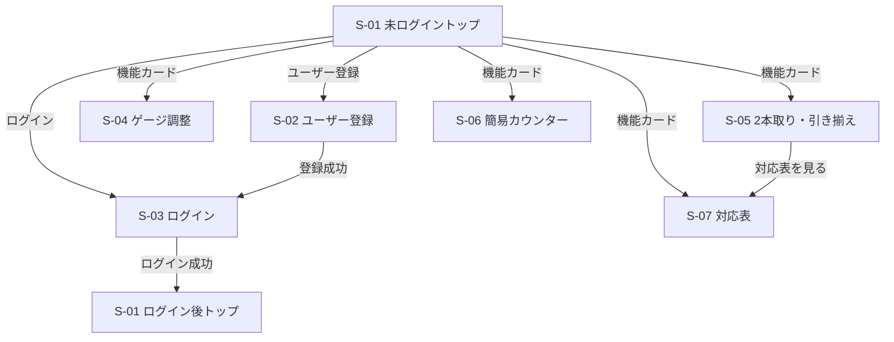
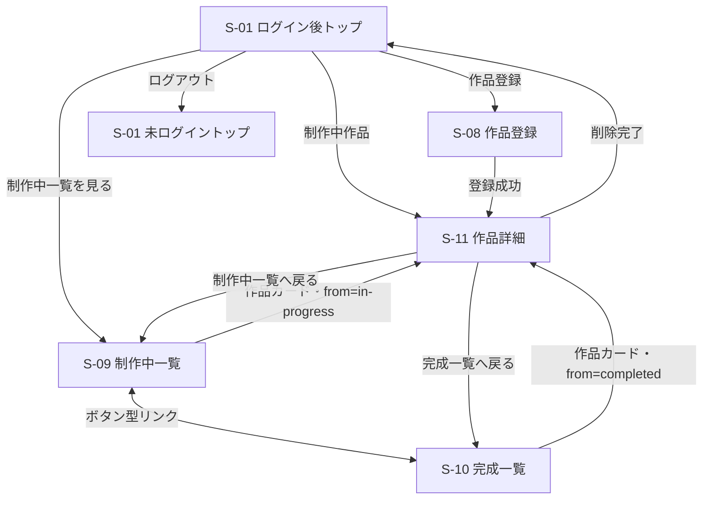

# Knitting 画面設計書

## 文書情報

| 項目 | 内容 |
| --- | --- |
| 対象システム | Knitting |
| 文書種別 | 画面設計書 |
| 作成日 | 2026年9月6日 |
| 最終更新日 | 2026年10月21日 |
| 文書状態 | 初期版の画面設計・実装内容を反映済み。資料見直し完了、GitHub一般公開済み |
| 実装状況 | S-01～S-11の主要機能を実装・確認済み。Step15「総合テスト」・Step16「UI最終調整」・Step17「エラー処理最終確認」を完了。README本文、要件定義書、基本設計書の見直しは完了。その他の設計資料の見直しとGitHub一般公開準備は未完了。Webアプリケーションの公開環境は未構築。 |
| 参照資料 | README.md、01_requirements.md、02_basic-design.md、04_database-design.md、05_detailed-design.md、S-01～S-11画面仕様検討書、共通デザイン・共通ナビゲーション仕様 |

> [!NOTE]
> 本書は、Knittingの各画面の構成、表示内容、入力項目、操作、画面遷移、エラー表示、レスポンシブ対応などをまとめた画面設計書です。Step17「エラー処理最終確認」までの完了内容を反映しています。
>
> 画面の表示・操作仕様を本書で扱い、機能要件は要件定義書、システム全体の構成は基本設計書、データベース構造はデータベース設計書、具体的な処理・実装構成は詳細設計書を参照してください。Webアプリケーションの公開環境に依存する事項や将来の検討事項は、確定済みの仕様と区別して記載します。

## 1. 本書の目的

本書は、要件定義書で定めた機能要件と、基本設計書で定めたユーザーから見た動作・画面構成を、実装時に参照できる画面単位の仕様へ具体化するものです。

各画面の利用条件、表示内容、入力項目、操作、画面遷移、状態保持、バリデーション、レスポンシブ表示を整理し、Spring Bootによる実装とGitHub上での設計説明に使用します。Javaクラス、URL、データベース構造、HTML・CSS・JavaScriptの具体的な実装方式は本書の対象外です。

## 2. 画面設計の基本方針

### 2.1 ログイン状態による違い

| 状態 | 基本方針 |
| --- | --- |
| 未ログイン | S-01～S-07の公開画面を利用できる。ログイン後用ハンバーガーメニューは表示しない |
| ログイン後 | 公開画面に加えて、本人の作品に関するS-08～S-11を利用できる |
| 未ログインでログイン必須画面へアクセス | S-03へ移動し、「この機能を利用するにはログインしてください。」と表示する |
| 他ユーザーの作品 | 閲覧・変更・削除できない。本人作品の取得条件で制御し、存在しない作品と同じ404として扱う |

### 2.2 レイアウトとレスポンシブ

- PC・スマートフォンの両方で利用できる構成とする。
- PCでは、対になる情報やカードを複数列で表示する。各画面で定めた列数を使用する。
- スマートフォンでは原則として縦1列へ切り替える。
- 画面幅767px以下ではスマートフォン向け、768px以上ではPC向けの表示を基本とする。ヘッダー・本文・フッターの共通領域は最大960pxを基本に中央へ配置し、狭い画面では左右の余白を残して縮小する。
- 余白・入力欄・ボタン・写真等の寸法は、各画面の表示内容と操作性に応じて設定する。共通のブレークポイントと最大幅は本節で定義し、画面固有の寸法は各画面の設計で扱う。
- ログイン後はPC・スマートフォンともに同じハンバーガーメニュー方式を使用する。

### 2.3 ロゴ・カード・主要操作

- ヘッダー左側に文字ロゴ「Knitting」を表示する。Nunitoを使用し、太さ800、文字サイズ2.25～2.5rem、ブルーグレー（#526d82）で強調する。専用画像ロゴは必須としない。
- トップの機能カード、トップの作品カード、作品一覧カードは、カード全体をクリック／タップ可能にする。
- カードでは主情報と補助情報に優先順位を付ける。作品名を主情報、目数・段数または完成日を補助情報として扱う。
- 主要ボタンと、戻るリンク等の補助操作は視覚的に区別する。
- 操作できないボタンは、無効であることが見た目でも分かるようにする。
- ページ背景は淡い色（#f8f8ff）、基本文字色は濃いグレー（#333333）とする。白いカード・入力領域を基本に、淡いブルー系・グレー系と、アクセントのピンクを組み合わせる。
- ブルー系ボタンの代表色は#d6e6f5、選択中の一覧・計算モードは#b0c4de、登録導線や計算実行等のアクセントは#ffe0eaとする。用途ごとの配色・無効状態は各画面の実装に従う。
- ボタン型リンクやカードにはホバー時の色・影を設定する。移動を伴う効果は、ホバー可能な細かいポインターと動きを減らす設定に応じて適用する。
- アイコンの追加は必須とせず、必要性が生じた場合に別途検討する。

### 2.4 入力フォームとエラー

- 入力項目は上から順に配置し、ラベルと入力欄の対応が分かる構成とする。PCではラベル・入力欄・単位等を横方向にそろえる画面があり、スマートフォンでは画面ごとの設計に従って折り返し・縮小する。補助説明や項目エラーは対象入力欄の付近へ表示する。
- 入力前に必要な文字数・形式等を把握できるよう、確定している入力条件を入力欄付近に表示する。
- 項目を特定できるエラーは該当入力欄の直下または付近へ表示する。
- 認証失敗等、特定項目に原因を結び付けないエラーはフォーム共通の位置へ表示する。
- 案内・成功メッセージとエラーメッセージは、役割が分かるように視覚的に区別する。
- 入力条件を満たさない間は、登録・ログイン・計算等の主要ボタンを無効にする画面がある。対象条件は各画面の設計に従う。
- パスワードの表示／非表示は、S-02とS-03で同じ位置・同じ操作方法に統一する。

### 2.5 確認操作

確認を表示する操作は次のとおりです。

| 操作 | 確認の扱い |
| --- | --- |
| 簡易カウンターの個別リセット | 確認なし |
| 簡易カウンターのすべてリセット | ブラウザ標準の確認を表示する |
| 制作ステータス変更 | 確認なし |
| 未保存の作品基本情報を残した画面移動 | 未保存警告を表示する |
| ログアウト | HTML標準ダイアログで確認する |
| 未保存状態でのログアウト | 未保存警告を含む1つのログアウト確認を表示する |
| 作品削除 | S-11内のHTML標準ダイアログで、関連情報も削除され復元できないことを確認する |

ログアウト、Knitting内のリンクによる未保存離脱、作品削除の確認には、白い背景、ブルー系の枠線、角丸・影を備えたHTML標準ダイアログを使用します。操作ボタンは配色と間隔によって区別し、PC・スマートフォンの画面内に収まる構成とします。

簡易カウンターの全体リセット、およびブラウザーの戻る・再読み込み・終了時の未保存離脱確認には、ブラウザー標準の確認ダイアログを使用します。その表示はブラウザーに従います。

### 2.6 初期画像

- 作品写真が登録されていない場合は、Knittingで用意する共通の初期画像を表示する。
- S-08では初期画像を最初からプレビューし、写真を選択した場合は選択画像へ更新する。
- S-11で写真を削除した場合は初期画像へ戻す。
- 開発環境では登録画像を設定されたファイル領域へ保存し、MySQLには論理参照情報のみを保持する。本番環境の物理保存先は公開環境決定後に確定する。
- JPEG／PNG、10MiB以下、幅・高さ8192px以下を受け付け、保存時は向きを補正し、アスペクト比を保ったまま長辺を最大1920pxへ縮小して再エンコードする。
- 共通初期画像には、淡いブルー・ピンク系の毛糸玉イラストを使用する。画像ファイルは `/images/default-work.png`（PNG）とし、初期版の素材・デザインは確定済みとする。

### 2.7 保存とデータ保持

| 対象 | 保存・保持方式 |
| --- | --- |
| S-11の作品名・作品写真・カテゴリー | 編集モードで変更し、「保存」で確定する。「キャンセル」で破棄する |
| S-11の目数・段数 | 変更時に作品ごとに自動保存する |
| S-11の制作メモ | 保存ボタンを設けず自動保存する |
| S-11の制作ステータス・完成日 | 変更時に自動保存する |
| S-06の目数・段数 | 保存ボタンを設けず自動保持し、ページ移動後・ブラウザ終了後も再開できるようにする |

- S-11の自動保存済み項目については、画面移動時の未保存警告を表示しない。
- S-11の作品基本情報を編集中で未保存の場合のみ、画面移動前に確認する。
- S-06は目数・段数をブラウザのlocalStorageへ個別に保存する。利用できない場合もページ内では動作を継続し、保持できない可能性を案内する。
- S-11はページ遷移を伴わない非同期通信で保存する。目数・段数は最後の操作から300ms後、制作メモは最後の入力から1秒後、制作ステータスと正常な完成日は変更確定後に即時保存する。
- 保存中・保存完了・保存失敗を対象付近に表示する。同時編集競合時は自動統合・自動再試行せず再読み込みを案内し、通信・サーバーエラー時はユーザー操作による再試行を提供する。

### 2.8 フッター

全画面のフッターに「© Knitting」を中央表示します。本文からの上余白は5remとし、ヘッダー・本文と共通の最大幅にそろえています。

## 3. 共通ナビゲーション設計

### 3.1 未ログイン時

| 項目 | 仕様 |
| --- | --- |
| ヘッダー左側 | 文字ロゴ「Knitting」 |
| 未ログイントップ右側 | 「ログイン」「ユーザー登録」 |
| ユーザー登録画面右側 | 「ログイン」。現在画面の「ユーザー登録」は重複表示しない |
| ログイン画面右側 | 「ユーザー登録」。現在画面の「ログイン」は重複表示しない |
| その他の公開画面右側 | 「ログイン」「ユーザー登録」 |
| ハンバーガーメニュー | 使用しない |
| 公開画面の戻る操作 | 「トップへ戻る」から未ログイントップへ移動する |
| フッター | 「© Knitting」 |

### 3.2 ログイン後

ログイン後は、PC・スマートフォンとも、ヘッダー左側に文字ロゴ「Knitting」、右側にハンバーガーメニューボタンを表示します。

#### メニュー構成

| 区分 | 項目 |
| --- | --- |
| トップ | トップ |
| 作品 | 作品を登録、制作中一覧、完成一覧 |
| 計算 | ゲージ・目数・段数調整、2本取り・引き揃え計算、簡易カウンター |
| 参考 | 毛糸・推奨針号数対応表 |
| アカウント操作 | ログアウト |

- 「作品」「計算」「参考」はメニュー内容を整理する区分です。
- 主要項目を一度に確認できる構成とし、何段階も展開するサブメニューにはしません。
- 各項目を選択すると、対象画面へ通常のページ遷移を行い、遷移後はメニューを閉じます。
- ログアウトは区切り線または十分な間隔を設けて最下部へ配置します。
- メニュー項目と並び順は、ログイン後の全画面で原則として共通とします。

#### 現在地表示

- 現在地は、ページ上部のページ名・見出しを主な手段として示します。
- メニュー内では、対応する1項目へ「▶」を付けて現在地を補助表示します。
- S-11では専用メニューを追加しません。制作中一覧または完成一覧から遷移した場合は、有効な遷移元情報に対応する「▶ 制作中一覧」または「▶ 完成一覧」を表示します。
- S-11で制作ステータスを変更しても、有効な遷移元情報がある場合は現在地強調と一覧への戻り先を維持します。遷移元情報がない場合は現在の制作ステータスから判定します。

#### ログアウト

- ログアウトを選択すると、「ログアウトしますか？」という趣旨の確認を表示します。
- 確認では「キャンセル」と「ログアウト」を選択できます。
- 未保存の作品基本情報がある場合は、「保存されていない変更内容は失われます」という趣旨を同じ確認内へ含めます。
- ログアウト後は未ログイントップへ移動します。

#### PC・スマートフォン

- どちらもハンバーガーメニューを使用し、項目・操作ルールを変えません。
- メニューボタンで、ヘッダー直下の枠付きメニューを開閉します。白い背景の中にボタン型の項目を配置し、PCでは基本3列、スマートフォンでは1列にします。区分見出しは列全体を使用します。
- メニューの下方も通常のページスクロールで確認できます。メニューボタンの文字・大きさ・配色、各項目の間隔は共通デザイン方針に従って統一し、PC・スマートフォンの両方で操作しやすい構成とします。

## 4. 画面一覧

| 画面ID | 画面名 | 利用条件 | 主な役割 |
| --- | --- | --- | --- |
| S-01 | トップ画面 | 共通 | 公開機能への入口。ログイン後は制作中作品も表示する |
| S-02 | ユーザー登録画面 | 未ログイン | 新しいユーザーアカウントを登録する |
| S-03 | ログイン画面 | 未ログイン | ログイン、自動ログイン選択、案内・認証エラーを表示する |
| S-04 | ゲージ・目数・段数調整画面 | 共通 | 指定ゲージと実測ゲージから調整後の目数・段数を計算する |
| S-05 | 2本取り・引き揃え計算画面 | 共通 | 2本使用時の換算糸長、毛糸の太さ、推奨針号数を計算する |
| S-06 | 簡易カウンター画面 | 共通 | 作品と紐づかない目数・段数を保持する |
| S-07 | 毛糸・推奨針号数対応表画面 | 共通 | 毛糸の太さ、長さ、推奨針の対応を一覧表示する |
| S-08 | 作品登録画面 | ログイン後 | 作品基本情報と初期ステータスを登録する |
| S-09 | 制作中一覧画面 | ログイン後 | 本人の制作中作品を一覧表示する |
| S-10 | 完成一覧画面 | ログイン後 | 本人の完成作品を一覧表示する |
| S-11 | 作品詳細画面 | ログイン後 | 作品情報、カウンター、メモ、状態、完成日、削除を管理する |

初期実装では計算機能一覧画面を設けません。共通エラー画面は400・403・404・500の4種類を設け、HTTPステータスを維持したまま内部情報を表示せず、トップへ戻る導線を提供します。

## 5. 画面遷移

### 5.1 未ログイン・公開機能

S-02～S-07の「トップへ戻る」は、未ログイン時にはS-01未ログイントップ、ログイン後の公開画面ではS-01ログイン後トップへ移動します。未ログインでS-08～S-11等へアクセスした場合は、案内付きのS-03へ移動します。

### 5.2 ログイン後の作品管理

ログイン後共通ナビゲーションからは、S-01、S-04～S-10へ移動できます。S-11は一覧またはトップの作品カード、S-08の登録成功後から表示します。

## 6. 各画面設計

### 6.1 S-01 トップ画面

#### 基本情報

| 項目 | 内容 |
| --- | --- |
| 画面ID | S-01 |
| 画面名 | トップ画面 |
| 利用条件 | 未ログイン／ログイン後 |
| 目的・役割 | 未ログイン時は公開機能と認証への入口、ログイン後は制作中作品と公開機能への入口を提供する |

#### 画面構成・表示項目

| 領域 | 未ログイン | ログイン後 |
| --- | --- | --- |
| ヘッダー | 文字ロゴ／ログイン／ユーザー登録。ハンバーガーなし | 文字ロゴ／ハンバーガーメニュー。「▶ トップ」を現在地表示 |
| ページ上部 | キャッチコピーと、公開機能・ユーザー登録に関する短い案内 | 制作中作品を主要コンテンツとして表示 |
| 作品領域 | 表示しない | 最終更新日時が新しい順の最新4件 |
| 公開機能 | 4つの機能カード | 制作中作品の下に同じ4つの機能カード |
| 登録案内 | 公開機能の下にユーザー登録案内を表示 | 「制作中の作品」見出し付近に「＋ 作品を登録」を表示 |
| フッター | © Knitting | © Knitting |

公開機能カードの順序は次のとおりです。

1. ゲージ・目数・段数調整
2. 2本取り・引き揃え計算
3. 簡易カウンター
4. 毛糸・推奨針号数対応表

- 機能カードは機能名を主表示とし、説明文は原則として表示しません。
- トップ用作品カードは、作品写真、作品名、補助情報として「目数 ○・段数 ○」を表示します。
- 写真未登録時は初期画像を表示します。
- 完成作品はトップへ表示せず、S-10で確認します。

#### ボタン・リンク・操作

| 表示・操作 | 条件 | 動作・遷移先 | 確認 |
| --- | --- | --- | --- |
| ログイン | 未ログイン | S-03 | なし |
| ユーザー登録 | 未ログイン | S-02 | なし |
| 公開機能カード | 共通 | 選択したS-04～S-07 | なし |
| ユーザー登録ボタン | 未ログイン | S-02 | なし |
| ログイン導線 | 未ログイン | S-03 | なし |
| 作品カード | ログイン後 | 対象作品のS-11 | なし |
| ＋ 作品を登録 | ログイン後 | S-08 | なし |
| 制作中一覧を見る | ログイン後 | S-09 | なし |

#### 状態・レスポンシブ

- ログイン後の制作中作品は最終更新日時が新しい順の先頭4件とします。
- PCでは、制作中作品を2列×2行、公開機能カードを2列で表示します。
- スマートフォンでは、作品カード・機能カードとも縦1列で表示します。

#### 表示・デザイン仕様

- キャッチコピーは「編み物の計算と記録を、もっとかんたんに。」とし、意味のまとまりが読み取れる位置で折り返して表示します。
- ロゴには共通のNunitoとブルーグレーを使用し、本文の主な見出しもブルーグレーで強調します。
- 公開機能カードは白い背景とブルー系の枠線で区切ります。ログイン・ユーザー登録、作品登録・制作中一覧への導線はボタン型とし、適切な間隔とホバー時の表示を設けます。
- カード・文字・余白はPC・スマートフォンの両方で見やすく配置します。キャッチコピーや追加アイコンの将来的な見直しは、必要性が生じた場合に別途検討します。
- ログイン後トップで制作中作品が0件の場合は「制作中の作品はありません。」を表示し、作品登録への導線、見出し付近の「＋ 作品を登録」、「制作中一覧を見る」を表示します。

### 6.2 S-02 ユーザー登録画面

#### 基本情報

| 項目 | 内容 |
| --- | --- |
| 画面ID | S-02 |
| 画面名 | ユーザー登録画面 |
| 利用条件 | 未ログイン |
| 目的・役割 | 登録条件を示し、新しいユーザーアカウントを登録する |

#### 画面構成

- ヘッダー左側に文字ロゴ、右側に「ログイン」を表示します。ハンバーガーメニューと「ユーザー登録」の重複表示は行いません。
- メイン領域は「ユーザー登録」見出し、入力フォーム、注意書き、主要ボタン、「トップへ戻る」の順を基本とします。
- フッターに「© Knitting」を表示します。
- PC・スマートフォンとも入力項目を縦方向へ配置します。

#### 入力・選択項目

| 項目 | 必須／任意 | 入力形式・条件 | 初期値 | 補足 |
| --- | --- | --- | --- | --- |
| メールアドレス | 必須 | メールアドレス形式。登録済みメールアドレスと重複不可 | 未入力 | 前後空白を除去して小文字へ正規化。エラーは入力欄直下 |
| ユーザー名 | 必須 | 4～20文字の半角英数字。登録済みユーザー名と重複不可 | 未入力 | 前後空白を除去。保存時の大文字・小文字は保持し、重複判定・ログイン時は区別しない |
| パスワード | 必須 | 8～64文字の印字可能なASCII文字。弱いパスワードは不可 | 未入力 | 前後空白を除去・正規化しない。表示／非表示切替あり |
| パスワード（確認） | 必須 | パスワードと完全一致 | 未入力 | 表示／非表示切替あり |

パスワードにはASCII spaceを使用できますが、制御文字と非ASCII文字は受け付けません。大文字・小文字・数字・記号の組み合わせ必須ルールは設けません。登録時はローカルのPassword Blocklistでパスワード全体を大文字・小文字を区別せず照合し、推測されやすい値を拒否します。

#### ボタン・リンク・操作

| 表示名 | 実行条件 | 動作・遷移先 | 確認 |
| --- | --- | --- | --- |
| ユーザー登録 | 全入力が正常 | 登録し、成功後にS-03へ移動 | なし |
| パスワード表示切替 | 常時 | パスワードと確認欄を個別に表示／非表示へ切り替える。初期・再表示時は非表示 | なし |
| ログイン | 常時 | S-03 | なし |
| トップへ戻る | 常時 | S-01未ログイントップ | なし |

初期版ではパスワード再設定機能を設けません。登録ボタン付近に「※初期版ではパスワード再設定機能には対応していません。」を基本候補とする注意書きを表示します。

#### バリデーション・エラー表示

- 入力条件は各入力欄付近へ常時表示します。
- 未入力、形式・文字数違反、重複、パスワード不一致がある間は登録ボタンを無効にします。
- エラーは対象入力欄の直下へ具体的に表示します。
- メッセージ例は「正しいメールアドレス形式で入力してください。」「このメールアドレスはすでに登録されています。」「4～20文字の半角英数字で入力してください。」「このユーザー名はすでに使用されています。」「8～64文字で入力してください。」「パスワードが一致しません。」です。
- メールアドレスとユーザー名の正式な重複確認は登録操作時にサーバーで行い、リアルタイムの通信による重複確認は行いません。
- 登録失敗時はメールアドレスとユーザー名を保持し、パスワードと確認用パスワードは保持・再表示しません。

#### 状態・画面遷移

- 登録成功後は自動ログインしません。
- 登録完了専用画面は作成せず、S-03へ移動して登録完了の案内を表示します。
- 主な遷移元はS-01、S-03です。

#### 表示・デザイン仕様

- 入力欄の幅・高さとラベルとの間隔を統一し、パスワードの「表示／非表示」ボタンを入力欄の右横へ配置します。
- PCではラベルと入力欄を横方向にそろえ、スマートフォンではラベルを上段へ配置します。
- 「ユーザー登録」と「トップへ戻る」のボタンは、幅・角丸・文字のデザインを統一し、各操作の役割が分かる配色とします。ボタン間には適切な余白を確保し、PC・スマートフォンの両方で操作しやすい構成とします。

### 6.3 S-03 ログイン画面

#### 基本情報

| 項目 | 内容 |
| --- | --- |
| 画面ID | S-03 |
| 画面名 | ログイン画面 |
| 利用条件 | 未ログイン |
| 目的・役割 | ユーザー名・パスワードで認証し、必要に応じて案内を表示する |

#### 画面構成

- ヘッダー左側に文字ロゴ、右側に「ユーザー登録」を表示します。ハンバーガーメニューと「ログイン」の重複表示は行いません。
- メイン領域は、必要な場合だけ表示する案内領域、「ログイン」見出し、入力フォーム、自動ログイン、主要ボタン、補助導線の順を基本とします。
- フッターに「© Knitting」を表示します。
- S-02とフォームの基本デザインを統一します。

#### 入力・選択項目

| 項目 | 必須／任意 | 入力形式・条件 | 初期値 | 補足 |
| --- | --- | --- | --- | --- |
| ユーザー名 | 必須 | 登録済みユーザー名。前後空白を除去し、大文字・小文字を区別しない | 未入力 | 未入力・形式不正は認証失敗として扱う |
| パスワード | 必須 | 登録済みパスワード | 未入力 | 値を加工せず照合。表示／非表示切替あり |
| 30日間ログイン状態を保持する | 任意 | チェックボックス | OFF | ONの場合は30日間保持 |

#### 案内・エラー

| 条件 | 種別 | 表示内容 |
| --- | --- | --- |
| 通常アクセス | なし | 案内なし |
| S-02で登録成功後 | 成功・案内 | 「ユーザー登録が完了しました。ログインしてください。」という趣旨 |
| 未ログインでログイン必須画面へアクセス | 案内 | 「この機能を利用するにはログインしてください。」 |
| ユーザー名未入力 | 項目エラー | 「ユーザー名を入力してください。」 |
| パスワード未入力 | 項目エラー | 「パスワードを入力してください。」 |
| 認証失敗 | フォーム共通エラー | 「ユーザー名またはパスワードが正しくありません。」という趣旨 |

認証失敗時は、ユーザー名とパスワードのどちらが原因かを表示しません。

#### ボタン・リンク・操作

| 表示名 | 実行条件 | 動作・遷移先 | 確認 |
| --- | --- | --- | --- |
| ログイン | ユーザー名・パスワード入力済み | 認証し、成功時にS-01ログイン後トップへ移動 | なし |
| パスワード表示切替 | パスワード欄表示中 | 入力内容の表示／非表示を切り替える | なし |
| ユーザー登録（ヘッダー） | 常時 | S-02 | なし |
| トップへ戻る | 常時 | S-01未ログイントップ | なし |

未入力項目がある間はログインボタンを無効にします。初期実装ではパスワード再設定へのリンクを設けません。

#### 状態・データ保持

- 自動ログインがOFFの場合は30日間の自動ログイン状態を使用しません。
- ONの場合はログイン成功時から30日間、自動ログイン情報をCookieで保持します。
- 利用のたびに30日の期限は延長しません。チェックボックスの初期値と認証失敗後はOFFです。
- 通常のログイン状態はセッションで保持し、30分間操作がない場合に終了します。有効な自動ログイン情報があれば新しいセッションで自動認証します。

#### 表示・デザイン仕様

- 入力欄・ラベル・パスワード表示切替のデザインをS-02と統一し、「表示／非表示」ボタンを入力欄の右横へ配置します。
- 入力欄の高さとログインボタンの大きさを統一し、自動ログインのチェックボックス・説明文とログインボタンの間には適切な余白を設けます。
- ログインボタンの下にユーザー登録リンクを重複表示せず、ユーザー登録への導線はヘッダーに配置します。
- 登録完了などの案内と認証エラーは、それぞれの役割が分かるように表示します。PC・スマートフォンの両方で、入力欄やボタンを操作しやすい構成とします。

### 6.4 S-04 ゲージ・目数・段数調整画面

#### 基本情報

| 項目 | 内容 |
| --- | --- |
| 画面ID | S-04 |
| 画面名 | ゲージ・目数・段数調整画面 |
| 利用条件 | 未ログイン／ログイン後 |
| 目的・役割 | 指定ゲージと実測ゲージの差から、調整後の目数・段数を計算する |

#### 画面構成

- ログイン状態に応じた共通ヘッダーを表示します。画面本体は共通です。
- 「ゲージ・目数・段数調整」見出しの下に、目数調整と段数調整の入力ブロックを表示します。
- 両ブロックの下に共通の「計算する」ボタン、同一ページ下部に結果領域・注意書きを配置します。
- 画面下部に「トップへ戻る」、フッターに「© Knitting」を表示します。
- PCでは目数・段数を左右2列、スマートフォンでは目数→段数の縦1列とします。

#### 入力項目

| 区分 | 項目 | 必須／任意 | 入力形式 | 単位 | 初期値 |
| --- | --- | --- | --- | --- | --- |
| 目数 | 指定目ゲージ | 条件付き | 0.01～999.99、小数第2位まで | 目 / 10cm | 未入力 |
| 目数 | 実測目ゲージ | 条件付き | 0.01～999.99、小数第2位まで | 目 / 10cm | 未入力 |
| 目数 | 元の目数 | 条件付き | 1～9999の整数 | 目 | 未入力 |
| 段数 | 指定段ゲージ | 条件付き | 0.01～999.99、小数第2位まで | 段 / 10cm | 未入力 |
| 段数 | 実測段ゲージ | 条件付き | 0.01～999.99、小数第2位まで | 段 / 10cm | 未入力 |
| 段数 | 元の段数 | 条件付き | 1～9999の整数 | 段 | 未入力 |

「条件付き」は、目数側または段数側を計算する場合、その側の3項目がすべて必要であることを示します。片側の3項目がすべて未入力なら、その側は計算対象外となりエラーにしません。ゲージは10cm基準のみを扱います。

#### 計算・結果表示

- 調整後の目数の計算値 ＝ 元の目数 × 実測目ゲージ ÷ 指定目ゲージ
- 調整後の段数の計算値 ＝ 元の段数 × 実測段ゲージ ÷ 指定段ゲージ
- 計算途中では端数処理を行わず、最終計算値を四捨五入して整数の調整結果を表示します。
- 四捨五入前の計算値は小数部最大5桁で表示し、不要な末尾0を表示しません。
- 結果領域には、入力内容、四捨五入前の計算値、四捨五入後の調整結果を区別して表示します。
- 目数側のみ、段数側のみ、両方のいずれでも計算できます。
- 計算後も入力値を残し、修正して再計算できます。

#### ボタン・リンク・操作

| 表示名 | 実行条件 | 動作・遷移先 | 確認 |
| --- | --- | --- | --- |
| 計算する | 入力した側の必要項目が正常 | 同一ページ下部へ結果表示 | なし |
| トップへ戻る | 常時 | ログイン状態に対応するS-01 | なし |

#### バリデーション・エラー表示

| 条件 | 動作 |
| --- | --- |
| 一方の3項目がすべて未入力 | その側は計算せず、エラーにしない |
| 一方の項目を一部だけ入力 | 不足項目を通知し、その側を計算しない |
| 0以下・非数値 | 該当項目付近へエラーを表示し、計算しない |
| 元の目数・元の段数が小数 | 整数入力が必要であることを表示し、計算しない |
| ゲージ4項目が範囲外、または小数第2位を超える | 該当項目付近へ「（項目名）は0.01～999.99の範囲で、小数第2位まで入力してください。」と表示し、計算しない |

結果付近に「計算結果は目安」であり、「実際の糸と針で試し編みを推奨する」趣旨の注意書きを表示します。

#### 表示・デザイン仕様

- 本文・見出しを中央基準で配置し、ラベル・入力欄・単位の位置をそろえます。PCでは入力行の上下に適切な余白を設け、スマートフォンではラベルを上段へ配置します。
- 画面タイトルと目数・段数それぞれの見出しは、文字サイズと余白によって階層を明確にし、狭い画面でも読みやすい構成とします。
- 「計算する」は入力欄との間に余白を設け、ピンク系のボタンとして「トップへ戻る」と視覚的に区別します。ボタンの角丸や文字のデザインを統一し、PC・スマートフォンの両方で入力欄の枠線とボタンを見やすく表示します。

### 6.5 S-05 2本取り・引き揃え計算画面

#### 基本情報

| 項目 | 内容 |
| --- | --- |
| 画面ID | S-05 |
| 画面名 | 2本取り・引き揃え計算画面 |
| 利用条件 | 未ログイン／ログイン後 |
| 目的・役割 | 2本使用時の100gあたりの換算糸長、毛糸の太さ、推奨針号数を計算する |

#### 画面構成

- ログイン状態に応じた共通ヘッダーを表示し、画面本体は共通とします。
- 「2本取り・引き揃え計算」見出しの下に、ボタン型のモード選択、入力領域、「計算する」、結果領域、関連リンク、注意書きを配置します。
- 画面下部に「トップへ戻る」、フッターに「© Knitting」を表示します。
- 引き揃えモードは、PCで糸1・糸2を左右2列、スマートフォンで縦1列に表示します。

#### モード

| モード | 初期表示 | 入力セット | 計算上の扱い |
| --- | :---: | --- | --- |
| 2本取り | ○ | 毛糸1本分 | 入力した1本分の1mあたりの重量を2倍する |
| 引き揃え | － | 糸1・糸2 | 異なる2本の1mあたりの重量を合計する |

- 「2本取り」「引き揃え」のボタン型選択UIで、同一画面内の入力フォームを切り替えます。ラジオボタンとしての選択とキーボード操作を維持し、選択中を色・太字で区別します。
- 画面を離れていない間は、モードを切り替えても各モードの入力値を保持します。
- 結果は選択中モードのものだけを表示します。
- 初期実装では3本以上を扱いません。

#### 入力項目

| モード | 対象 | 項目 | 必須／任意 | 入力形式 | 単位 | 初期値 |
| --- | --- | --- | --- | --- | --- | --- |
| 2本取り | 毛糸1本分 | 重量 | 必須 | 0.01～99999.99、小数第2位まで | g | 未入力 |
| 2本取り | 毛糸1本分 | 長さ | 必須 | 0.01～99999.99、小数第2位まで | m | 未入力 |
| 引き揃え | 糸1 | 重量 | 必須 | 0.01～99999.99、小数第2位まで | g | 未入力 |
| 引き揃え | 糸1 | 長さ | 必須 | 0.01～99999.99、小数第2位まで | m | 未入力 |
| 引き揃え | 糸2 | 重量 | 必須 | 0.01～99999.99、小数第2位まで | g | 未入力 |
| 引き揃え | 糸2 | 長さ | 必須 | 0.01～99999.99、小数第2位まで | m | 未入力 |

重量欄の近くに「g」、長さ欄の近くに「m」を常時表示します。

#### 計算・結果表示

1. 各毛糸の「重量（g）÷長さ（m）」で1mあたりの重量を求めます。
2. 2本分の1mあたりの重量を合計します。2本取りでは1本分を2倍します。
3. 「100÷組み合わせ後の1mあたりの重量」で100gあたりの換算糸長を求めます。
4. 換算糸長を整数へ四捨五入し、「約○m / 100g」と表示します。
5. 対応表と同じ基準で、推定毛糸太さ、推奨棒針号数、推奨かぎ針号数を表示します。

結果領域は「入力内容」見出し→入力内容の表→「計算結果」見出し→計算結果の表→S-07へのリンクボタン→注意書きブロックの順に表示します。計算結果の表では「約○m / 100g」、推定毛糸太さ、推奨棒針、推奨かぎ針を示します。入力内容の表はブルー系、計算結果の表はピンク系で区別します。途中計算値は原則として表示せず、最終結果を中心にします。

#### ボタン・リンク・操作

| 表示名 | 実行条件 | 動作・遷移先 | 確認 |
| --- | --- | --- | --- |
| 2本取り／引き揃えの選択 | 常時 | 表示する入力セットと結果を切り替える | なし |
| 計算する | 選択中モードの全入力が正常 | 同一ページ下部へ結果表示 | なし |
| 毛糸・推奨針号数対応表を見る | 計算結果付近 | S-07へ通常遷移 | なし |
| トップへ戻る | 常時 | ログイン状態に対応するS-01 | なし |

#### 入力変更後の再計算

- 計算後に入力値を変更しても、直前の結果は表示したままにします。
- 結果領域に「入力内容が変更されています。再計算してください。」という趣旨の案内を表示します。
- 再度「計算する」を実行したら結果を更新し、案内を非表示にします。

#### バリデーション・注意書き

- 選択中モードの空欄、0、負数、非数値は入力エラーとし、該当項目付近へ表示します。
- 入力条件を満たさない間は「計算する」を無効にします。
- 結果付近に、重量・長さだけによる目安であり、素材・撚り・毛足・糸の構造等によって差が生じるため試し編みを推奨する旨を表示します。

#### 表示・デザイン仕様

- 計算モードの選択UIは、制作中・完成一覧の切り替えと共通のデザインとします。選択中のモードは配色・太字で強調し、キーボード操作時のフォーカスも判別できるようにします。
- 重量・長さの入力欄と単位の位置をそろえ、入力欄や計算結果の表が重ならないように適切な余白を設けます。
- 「計算する」はS-04と同じピンク系のボタンとし、角丸・文字サイズ・ボタンの大きさを統一します。
- 計算結果からS-07「毛糸・推奨針号数対応表」へ移動するリンクはボタン型とし、計算結果の表との間に余白を設けます。注意書きは背景と枠線のある独立したブロックとして表示します。
- 入力内容の表はブルー系、計算結果の表はピンク系で区別します。PC・スマートフォンの両方で、入力・計算結果・関連リンクを確認しやすい構成とします。

### 6.6 S-06 簡易カウンター画面

#### 基本情報

| 項目 | 内容 |
| --- | --- |
| 画面ID | S-06 |
| 画面名 | 簡易カウンター画面 |
| 利用条件 | 未ログイン／ログイン後 |
| 目的・役割 | 作品登録とは別に、目数・段数を手軽に数えて保持する |

#### 画面構成

- ログイン状態に応じた共通ヘッダーを表示し、画面本体は共通とします。
- 「簡易カウンター」見出し付近に「作品とは別に、目数・段数を手軽に数えられるカウンターです。」と表示します。
- 目数・段数カウンター、「すべてリセット」、「トップへ戻る」の順を基本とします。
- PCでは目数・段数を左右2列、スマートフォンでは縦1列で表示します。
- フッターに「© Knitting」を表示します。

#### カウンター仕様

| 項目 | 目数 | 段数 |
| --- | --- | --- |
| 初回利用時の初期値 | 0 | 0 |
| 範囲 | 0～9999 | 0～9999 |
| ＋／－ | 1ずつ増減 | 1ずつ増減 |
| 任意値設定 | 現在値欄への直接入力 | 現在値欄への直接入力 |
| 個別リセット | 0へ戻す | 0へ戻す |
| 値の保持 | 自動保持 | 自動保持 |

- 操作形式は「－ / 現在値 / ＋」とします。
- 0のときは「－」、9999のときは「＋」を無効にします。
- ＋／－と直接入力による変更は、保存ボタンなしで自動保持します。

#### 直接入力・バリデーション

- 0～9999の整数を入力できます。
- 半角数字を受け付け、全角数字は半角へ自動変換して扱います。
- ひらがな、漢字、英字、記号等の数字以外、小数、負数、9999を超える値は受け付けません。
- 不正な値の場合は、入力欄付近に「0～9999の整数で入力してください。」という趣旨のエラーを表示します。
- 直接入力欄は数字キーボードを呼び出しやすいテキスト入力とし、入力途中の一時的な空欄を許可します。空欄または不正値のままフォーカスを外した場合は最後の正常値へ戻します。

#### ボタン・リンク・操作

| 表示名 | 実行条件 | 動作・遷移先 | 確認 |
| --- | --- | --- | --- |
| － | 現在値が1以上 | 1減らして自動保持 | なし |
| ＋ | 現在値が9998以下 | 1増やして自動保持 | なし |
| リセット | 常時 | 対象カウンターだけ0へ戻す | なし |
| すべてリセット | 常時 | 目数・段数を0へ戻す | あり。キャンセル時は変更しない |
| トップへ戻る | 常時 | ログイン状態に対応するS-01 | なし |

#### 状態・データ保持

- ページ移動後も値を保持し、S-06再表示時に前回値を表示します。
- 通常はブラウザ終了後も保持し、再アクセス時に前回値から再開します。
- 保存データの削除、保存が制限される閲覧方法、別ブラウザ・別端末等では前回値を利用できない場合があります。
- 目数・段数は別々のlocalStorageキーへ文字列として保存し、正常値が確定した時点で即時更新します。
- localStorageの保存値が不正な場合は該当する側だけ0へ復旧します。
- localStorageが利用できない場合もページ内では利用できるようにし、ページ移動・再読み込み・終了後に値を保持できない可能性を案内します。
- ログインしても作品へ自動的に紐づけず、S-11の作品専用カウンターへ移行しません。

#### 表示・デザイン仕様と将来検討

- 目数・段数の現在値は読みやすい文字サイズで表示し、現在値の入力欄と「－／＋」ボタンの高さをそろえます。「－／＋」ボタンは淡いブルー系の配色と太字で強調します。
- 個別リセットと入力欄の間、および個別リセットと「すべてリセット」の間には適切な余白を設け、誤操作を防ぎやすい構成とします。
- PCでは目数・段数を左右2列、スマートフォンでは縦1列に配置し、どちらでもカウンターとリセット操作を使いやすく表示します。
- 簡易カウンターの値を新規または既存の作品へ引き継ぐ機能は、初期版には含めず、将来の拡張機能として検討します。

### 6.7 S-07 毛糸・推奨針号数対応表画面

#### 基本情報

| 項目 | 内容 |
| --- | --- |
| 画面ID | S-07 |
| 画面名 | 毛糸・推奨針号数対応表画面 |
| 利用条件 | 未ログイン／ログイン後 |
| 目的・役割 | 毛糸の太さと100gあたりの長さ、推奨棒針・かぎ針を一覧で確認する |

#### 画面構成・表示項目

- ログイン状態に応じた共通ヘッダーを表示します。
- 1つの対応表、注意書き、「トップへ戻る」、フッターの順を基本とします。
- 初期実装では表の切り替え、検索、絞り込みを設けません。

| 列 | 表示内容 |
| --- | --- |
| 毛糸の太さ | 太さ区分 |
| 100gあたりの長さ（m） | 区分に対応する長さ範囲 |
| 推奨棒針 | 同一セル内に「号数」と「太さ（mm）」を2行で表示 |
| 推奨かぎ針 | 同一セル内に「号数」と「太さ（mm）」を2行で表示 |

対応表は、一般的なウール系ストレートヤーンを基準とする次の7区分を、この順序で表示します。

| 毛糸の太さ | 100gあたりの長さ | 推奨棒針 | 推奨かぎ針 |
| --- | ---: | --- | --- |
| 極細 | 800m以上 | 0～2号 / 2.1～2.7mm | 2/0号 / 2.0mm |
| 合細 | 500～799m | 1～3号 / 2.4～3.0mm | 2/0～3/0号 / 2.0～2.3mm |
| 中細 | 350～499m | 2～4号 / 2.7～3.3mm | 2/0～4/0号 / 2.0～2.5mm |
| 合太 | 250～349m | 4～6号 / 3.3～3.9mm | 4/0～5/0号 / 2.5～3.0mm |
| 並太 | 175～249m | 6～8号 / 3.9～4.5mm | 5/0～7/0号 / 3.0～4.0mm |
| 極太 | 101～174m | 9～11号 / 4.8～5.4mm | 8/0～10/0号 / 5.0～6.0mm |
| 超極太 | 100m以下 | 12号以上 / 5.7mm以上 | 10/0号以上 / 6.0mm以上 |

#### 表示・操作

- 縦に長い表として表示し、縦スクロール中も列見出しを確認できるよう表ヘッダーを固定します。
- PCでは4列の表を通常表示します。
- スマートフォンでもカード化せず表形式を維持し、幅に収まらない場合は表全体を横スクロールできるようにします。
- S-05から遷移した場合も通常のS-07を表示し、該当行への自動スクロール・色付け・強調は行いません。
- 画面下部の「トップへ戻る」は、ログイン状態に対応するS-01へ移動します。

#### 注意書き

表の直下に、一般的なウール系ストレートヤーンを基準とした目安であり、素材・撚り・膨らみ・毛足・糸の構造等で差が生じること、商品表示がある場合はメーカー推奨値を優先して試し編みする旨を表示します。

#### 表示・デザイン仕様

- 対応表と本文を中央基準で配置します。表の文字サイズは1.125remとし、行間・セルの余白・罫線を統一します。推奨針の列は左右に十分な余白を設け、号数とmm表示を読み取りやすくします。
- 表の見出し行は淡いブルー系、データセルは白い背景とし、ページ背景と区別します。
- 表のスクロール領域は画面高の60%を上限とします。表内を縦スクロールする際は列見出しを上端に固定し、各列の項目を確認できるようにします。
- スマートフォンでも4列の表形式を維持し、画面幅に収まらない場合は横スクロールで閲覧できるようにします。表の末尾まで確認できる構成とします。
- ページタイトルはPC・スマートフォンそれぞれの画面幅に応じた文字サイズと折り返しを設定し、狭い画面でも読みやすく表示します。

### 6.8 S-08 作品登録画面

#### 基本情報

| 項目 | 内容 |
| --- | --- |
| 画面ID | S-08 |
| 画面名 | 作品登録画面 |
| 利用条件 | ログイン後 |
| 目的・役割 | 作品の基本情報と初期ステータスを登録し、作品詳細での制作管理へつなげる |

#### 画面構成

- ヘッダーはログイン後共通ナビゲーションを使用し、「作品を登録」を現在地として表示します。
- 「作品を登録」見出しの下に、写真プレビュー、作品名、カテゴリー、制作ステータス、「登録する」、「トップへ戻る」を配置します。
- 目数・段数・制作メモは入力せず、登録後のS-11で管理します。
- フォームはPC・スマートフォンとも縦配置を基本とします。
- 写真プレビューは画面幅に応じて縮小します。
- フッターに「© Knitting」を表示します。

#### 入力・選択項目

| 項目 | 必須／任意 | 入力・選択方法 | 条件 | 初期値 | 補足 |
| --- | --- | --- | --- | --- | --- |
| 作品写真 | 任意 | 画像選択 | JPEG／PNG、10MiB以下、幅・高さ8192px以下、1作品につき1枚 | Knittingの初期画像 | 「ファイルを選択」で画像を選択し、全体をプレビュー |
| 作品名 | 必須 | テキスト入力 | 1～50文字。重複可 | 未入力 | 同一ユーザー内の同名登録を許可 |
| カテゴリー | 必須 | プルダウン | 8種類から1つ | 未選択 | 「選択してください」等を表示 |
| 制作ステータス | 必須 | ラジオボタン | 制作中／完成 | 制作中 | 完成を選択した場合は登録日を完成日の初期値にする |

カテゴリーは「帽子・上衣・下衣・マフラー・バッグ・ぬいぐるみ・小物・その他」です。作品登録画面では完成日を直接入力・変更しません。

#### ボタン・リンク・操作

| 表示名 | 実行条件 | 動作・遷移先 | 確認 |
| --- | --- | --- | --- |
| ファイルを選択（作品写真） | 常時 | 容量の事前検証を通過した写真へプレビューを変更 | なし |
| 登録する | 作品名・カテゴリー等が正常 | 登録し、対象作品のS-11へ移動 | なし |
| トップへ戻る | 常時 | S-01ログイン後トップ | なし |

#### バリデーション・エラー表示

- 作品名未入力、1～50文字の範囲外、カテゴリー未選択の場合は登録できません。
- 入力エラーは対象項目付近へ具体的に表示します。
- 作品名・カテゴリー・必須選択等の入力条件を満たさない間は「登録する」を無効にします。送信中も無効にして二重送信を防止します。画像の検証はサーバー側でも行い、エラーを項目付近へ表示します。
- 写真未選択はエラーにせず、初期画像のまま登録できます。
- 拡張子、MIME Type、実画像形式が一致し、JPEG／PNGとして正常に読み込めることをサーバー側で確認します。
- 10MiBを超える画像は送信前に検証し、登録画面に留まったまま写真選択欄付近へ「画像は10MB以下のファイルを選択してください。」と表示し、「登録する」を無効にします。作品名等の入力は保持し、写真プレビューは初期画像を維持します。正常画像へ選び直すと容量エラーを消し、選択画像をプレビューして、他の入力条件も満たす場合は登録ボタンを有効にします。
- サーバーで入力エラーとなり登録画面を再表示した場合は選択ファイルを保持せず、初期画像へ戻して再選択を求めます。画像保存に関するシステムエラー時は、写真なしで作品だけを登録しません。サーバー側の10MiB制限・画像検証は維持しており、Multipart受信段階で拒否されたすべてのリクエストを登録画面へ戻す変更ではありません。

#### 主な遷移元

- ログイン後共通ナビゲーション。
- S-01ログイン後トップ、S-09、S-10の見出し付近にある「＋ 作品を登録」。
- S-09・S-10の全体0件時に表示する「作品を登録する」。

#### 表示・デザイン仕様

- 作品写真のプレビューは幅・高さを最大27remとし、狭い画面では表示幅に収まるよう縮小します。
- 作品名・カテゴリー・制作ステータス・登録操作は、それぞれの入力項目と操作の関係が分かるように配置し、適切な余白を設けます。画像形式・容量の注意書きはファイル選択欄の近くに表示します。
- 作品名・カテゴリーの入力欄、ファイル選択・登録ボタンは操作しやすい大きさとし、「登録する」と「トップへ戻る」の間には適切な余白を確保します。
- 制作ステータスは幅を抑えた白い枠内に配置し、「制作中」「完成」の選択肢を操作しやすい間隔で表示します。
- 作品名は前後の所定の空白を除いたUnicodeコードポイント数で1～50文字と判定し、ブラウザー側とサーバー側で同じ基準を使用します。
- 作品写真が未登録の場合は、淡いブルー・ピンク系の毛糸玉イラストを共通初期画像として表示します。画像ファイルは `/images/default-work.png`（PNG）を使用し、初期版の素材・デザインは確定済みとします。
- PC・スマートフォンの両方で、写真プレビュー、入力欄、選択項目、登録ボタンを見やすく操作しやすい構成とします。

### 6.9 S-09 制作中一覧画面

#### 基本情報

| 項目 | 内容 |
| --- | --- |
| 画面ID | S-09 |
| 画面名 | 制作中一覧画面 |
| 利用条件 | ログイン後 |
| 目的・役割 | ログインユーザー本人の制作中作品を一覧表示し、作品詳細へつなげる |

#### 画面構成

- ログイン後共通ヘッダーを表示し、メニューの「▶ 制作中一覧」を現在地として強調します。
- 画面上部に「制作中」「完成」のボタン型リンクを表示し、「制作中」を選択中として表示します。
- 「制作中の作品」見出し付近に「＋ 作品を登録」を常時表示します。
- カテゴリー絞り込み、作品カード一覧、必要な場合のページ切り替えを表示します。
- フッターに「© Knitting」を表示します。

#### 表示対象・並び順

| 項目 | 仕様 |
| --- | --- |
| 表示対象 | ログインユーザー本人の制作ステータスが「制作中」の作品 |
| 並び順 | 最終更新日時が新しい順 |
| 絞り込み後 | 最終更新日時が新しい順を維持 |
| 1ページの上限 | 10作品 |
| PC | 2列×5行 |
| スマートフォン | 1列 |

#### 作品カード

| 表示・操作 | 仕様 |
| --- | --- |
| 作品写真 | 登録写真。未登録時は初期画像 |
| 作品名 | 主情報。最大2行とし、超える部分は省略表示 |
| 目数・段数 | 「目数 ○・段数 ○」等の形式で表示。1.3remに拡大し、上部の写真・作品名と区切り線で分ける |
| カード操作 | カード全体から対象作品のS-11へ移動 |
| 一覧内操作 | 編集、削除、ステータス変更、カウンター操作は行わない |

#### カテゴリー絞り込み

- プルダウン形式とし、初期値は「すべて」です。
- 選択肢は「すべて・帽子・上衣・下衣・マフラー・バッグ・ぬいぐるみ・小物・その他」です。
- 変更時は、選択カテゴリーの制作中作品だけを表示し、1ページ目へ戻します。

#### ページ切り替え

- 11作品以上の場合に一覧下部の中央付近へ「前へ・ページ番号・次へ」を表示します。
- 10作品以下では表示しません。
- 総ページ数が7以下の場合は全ページ番号、8以上の場合は先頭・末尾・現在ページ付近を表示し、その間をリンクなしの「…」で省略します。
- 先頭ページでは「前へ」、最終ページでは「次へ」を無効にし、現在ページはリンクにしません。
- ページ切り替え時は選択中カテゴリーを維持します。
- 不正なカテゴリー、1未満または総ページ数を超えるページが指定された場合は、400の共通エラー画面を表示します。

#### 0件時の表示

| 状態 | メッセージ | 補助操作 |
| --- | --- | --- |
| 制作中作品が0件 | 「制作中の作品はありません。」 | 「作品を登録する」 |
| 絞り込み結果が0件 | 「このカテゴリーの制作中作品はありません。」 | 「すべて表示」等の絞り込み解除 |

0件時でも、見出し付近の「＋ 作品を登録」は表示したままとします。

#### ボタン・リンク・操作

| 表示名 | 動作・遷移先 | 確認 |
| --- | --- | --- |
| 制作中（切替リンク） | S-09。選択中表示 | なし |
| 完成（切替リンク） | S-10へ通常遷移 | なし |
| ＋ 作品を登録／作品を登録する | S-08 | なし |
| 作品カード | 対象作品のS-11 | なし |
| 前へ・ページ番号・次へ | 対象ページを表示 | なし |
| すべて表示 | カテゴリー絞り込みを解除 | なし |

#### 表示・デザイン仕様

- 見出し・「＋ 作品を登録」・カテゴリー絞り込み・作品カード領域は、PC・スマートフォンとも中央を基準に配置し、各領域の間に適切な余白を設けます。
- 制作中・完成の切り替えリンク、カテゴリー絞り込み、ページ切り替えは、スマートフォンでも操作しやすい大きさと間隔を確保します。
- 作品写真は4:3の領域に中央基準で表示し、必要に応じて表示上のみトリミングします。元画像のデータは変更しません。
- 作品名はPC・スマートフォンとも最大2行で表示し、超える部分はCSSで省略します。作品名のデータ自体は切り詰めず、カード内には2行分の表示領域を確保します。
- 作品カードには枠線・角丸・余白を設け、写真・作品名と目数・段数の情報を視覚的に区別します。カード全体をリンクとし、文字色は通常の本文色を使用しながら、ホバー時の影などで操作可能であることを示します。
- 制作中・完成の切り替えでは選択中の項目をブルー系で強調し、「＋ 作品を登録」はピンク系のボタン型リンクとして表示します。
- PCでは作品カードを2列、スマートフォンでは1列に配置します。カテゴリー絞り込みの幅や配置も画面幅に応じて調整し、一覧を閲覧・操作しやすい構成とします。

### 6.10 S-10 完成一覧画面

#### 基本情報

| 項目 | 内容 |
| --- | --- |
| 画面ID | S-10 |
| 画面名 | 完成一覧画面 |
| 利用条件 | ログイン後 |
| 目的・役割 | ログインユーザー本人の完成作品を一覧表示し、作品詳細へつなげる |

#### 画面構成

- ログイン後共通ヘッダーを表示し、メニューの「▶ 完成一覧」を現在地として強調します。
- 画面上部に「制作中」「完成」のボタン型リンクを表示し、「完成」を選択中として表示します。
- 「完成作品」見出し付近に「＋ 作品を登録」を常時表示します。
- カテゴリー絞り込み、作品カード一覧、必要な場合のページ切り替えを表示します。
- フッターに「© Knitting」を表示します。

#### 表示対象・並び順

| 項目 | 仕様 |
| --- | --- |
| 表示対象 | ログインユーザー本人の制作ステータスが「完成」の作品 |
| 並び順 | 完成日が新しい順 |
| 絞り込み後 | 完成日が新しい順を維持 |
| 1ページの上限 | 10作品 |
| PC | 2列×5行 |
| スマートフォン | 1列 |

- 作品名、写真、カテゴリー、目数・段数、制作メモ等の変更だけでは並び順を変更しません。
- S-11で完成日を変更した場合は、変更後の日付に基づいて並び順を更新します。

#### 作品カード

| 表示・操作 | 仕様 |
| --- | --- |
| 作品写真 | 登録写真。未登録時は初期画像 |
| 作品名 | 主情報。最大2行とし、超える部分は省略表示 |
| 完成日 | 「完成日：YYYY/MM/DD」の形式で表示。1.3remに拡大し、上部の写真・作品名と区切り線で分ける |
| カード操作 | カード全体から対象作品のS-11へ移動 |
| 一覧内操作 | 編集、削除、ステータス変更、完成日変更は行わない |

#### カテゴリー絞り込み

- プルダウン形式とし、初期値は「すべて」です。
- 選択肢は「すべて・帽子・上衣・下衣・マフラー・バッグ・ぬいぐるみ・小物・その他」です。
- 変更時は、選択カテゴリーの完成作品だけを表示し、1ページ目へ戻します。

#### ページ切り替え

- 11作品以上の場合に一覧下部の中央付近へ「前へ・ページ番号・次へ」を表示します。
- 10作品以下では表示しません。
- 総ページ数が7以下の場合は全ページ番号、8以上の場合は先頭・末尾・現在ページ付近を表示し、その間をリンクなしの「…」で省略します。
- 先頭ページでは「前へ」、最終ページでは「次へ」を無効にし、現在ページはリンクにしません。
- ページ切り替え時は選択中カテゴリーを維持します。
- 不正なカテゴリー、1未満または総ページ数を超えるページが指定された場合は、400の共通エラー画面を表示します。

#### 0件時の表示

| 状態 | メッセージ | 補助操作 |
| --- | --- | --- |
| 完成作品が0件 | 「完成した作品はありません。」 | 「作品を登録する」 |
| 絞り込み結果が0件 | 「このカテゴリーの完成作品はありません。」 | 「すべて表示」等の絞り込み解除 |

0件時でも、見出し付近の「＋ 作品を登録」は表示したままとします。

#### ボタン・リンク・操作

| 表示名 | 動作・遷移先 | 確認 |
| --- | --- | --- |
| 制作中（切替リンク） | S-09へ通常遷移 | なし |
| 完成（切替リンク） | S-10。選択中表示 | なし |
| ＋ 作品を登録／作品を登録する | S-08 | なし |
| 作品カード | 対象作品のS-11 | なし |
| 前へ・ページ番号・次へ | 対象ページを表示 | なし |
| すべて表示 | カテゴリー絞り込みを解除 | なし |

#### 表示・デザイン仕様

- 見出し・「＋ 作品を登録」・カテゴリー絞り込み・作品カード領域は、PC・スマートフォンとも中央を基準に配置し、各領域の間に適切な余白を設けます。
- 制作中・完成の切り替えリンク、カテゴリー絞り込み、ページ切り替えは、スマートフォンでも操作しやすい大きさと間隔を確保します。
- 作品写真は4:3の領域に中央基準で表示し、必要に応じて表示上のみトリミングします。元画像のデータは変更しません。
- 作品名はPC・スマートフォンとも最大2行で表示し、超える部分はCSSで省略します。作品名のデータ自体は切り詰めず、カード内には2行分の表示領域を確保します。
- 作品カードには枠線・角丸・余白を設け、写真・作品名と完成日の情報を視覚的に区別します。完成日は「完成日：YYYY/MM/DD」の形式で表示し、文字サイズは1.3remとします。
- カード全体をリンクとし、文字色は通常の本文色を使用しながら、ホバー時の影などで操作可能であることを示します。
- 制作中・完成の切り替えでは選択中の項目をブルー系で強調し、「＋ 作品を登録」はピンク系のボタン型リンクとして表示します。
- PCでは作品カードを2列、スマートフォンでは1列に配置します。カテゴリー絞り込みの幅や配置も画面幅に応じて調整し、一覧を閲覧・操作しやすい構成とします。

### 6.11 S-11 作品詳細画面

#### 基本情報

| 項目 | 内容 |
| --- | --- |
| 画面ID | S-11 |
| 画面名 | 作品詳細画面 |
| 利用条件 | ログイン後。ログインユーザー本人の作品のみ |
| 目的・役割 | 作品情報の確認・編集、作品専用カウンター、制作メモ、状態・完成日、作品削除を1画面で管理する |

#### 画面構成

画面内の基本順序は次のとおりです。

1. 画面上部：編集／一覧へ戻る
2. 作品基本情報：写真／作品名／カテゴリー
3. 作品専用カウンター：目数／段数
4. 制作メモ
5. 作品の状態：制作ステータス／完成日（完成時のみ）
6. 作品削除

- ヘッダーにはログイン後共通ナビゲーションを表示します。
- S-09から遷移した場合は「▶ 制作中一覧」、S-10から遷移した場合は「▶ 完成一覧」を現在地として表示します。
- 有効な遷移元情報がある場合は、制作ステータス変更後も現在地表示と一覧への戻り先を遷移元一覧に維持します。遷移元情報がない場合のみ、現在の制作ステータスから判定します。
- フッターに「© Knitting」を表示します。

#### 画面上部

| 位置 | 表示・操作 | 仕様 |
| --- | --- | --- |
| 左上 | 編集 | 作品写真・作品名・カテゴリーを編集モードにする |
| 右上 | ⬅ 制作中一覧へ戻る | S-09から遷移した場合、または遷移元情報なしで現在の状態が制作中の場合にS-09へ移動 |
| 右上 | ⬅ 完成一覧へ戻る | S-10から遷移した場合、または遷移元情報なしで現在の状態が完成の場合にS-10へ移動 |

編集と一覧へ戻る操作は、PC・スマートフォンとも左右の横並びを基本とし、幅が足りない場合だけ折り返します。両方を同じグレー系のボタン型にそろえ、戻る矢印は1.3remの太字で強調します。ホバー時の影・動きもそろえています。

#### 作品基本情報と編集

| 項目 | 通常時 | 編集時 | 条件・補足 |
| --- | --- | --- | --- |
| 作品写真 | 現在写真または初期画像を全体表示 | 「写真を変更」でJPEG／PNGへ差し替え、削除可能 | 10MiB以下、幅・高さ8192px以下。削除後は初期画像 |
| 作品名 | 閲覧表示 | テキスト入力 | 必須、1～50文字、重複可 |
| カテゴリー | 閲覧表示 | プルダウン | 必須、S-08と同じ8種類 |

- 「編集」を押すと3項目を編集可能にし、「保存」「キャンセル」を表示します。
- 「保存」を押した場合のみ変更を確定します。保存中は二重送信を防止します。
- 作品名が未入力・空白のみの場合は「作品名を入力してください。」、50文字を超える場合は「作品名は50文字以内で入力してください。」を項目付近に表示し、「保存」を無効にします。作品名は前後の所定の空白を除いたUnicodeコードポイント数で1～50文字と判定し、絵文字等を含む場合もブラウザー側とサーバー側で同じ文字数判定基準を使用します。正式な入力検証はサーバー側で行います。
- 10MiBを超える画像を選択した場合は、同じ画面に「画像は10MB以下のファイルを選択してください。」と表示し、「保存」を無効にします。画像の変更・削除、作品名の変更、キャンセルに応じて保存可否を再判定します。画像形式・容量・寸法はサーバー側でも検証します。
- 不正な画像による保存失敗時は、既存の作品基本情報・保存済み画像を変更しません。複数タブで同じ作品の基本情報を編集して保存競合が発生した場合は、先に保存された情報を保護し、競合した側の変更は保存しません。競合を案内したうえで、最新の作品詳細を閲覧状態で表示します。この扱いは、自動保存で発生するHTTP 409の競合処理とは区別します。
- 「キャンセル」では変更を破棄し、編集前の閲覧状態へ戻します。
- 未保存のままKnitting内の通常リンクで画面移動する場合は、HTML標準ダイアログで「変更内容が保存されていません。画面を移動しますか？」と確認します。ブラウザの戻る・進む、再読み込み、終了等はブラウザ標準の離脱確認を使用します。
- 未保存のままログアウトする場合は、未保存警告をログアウト確認へまとめます。

#### 作品専用カウンター

| 項目 | 目数 | 段数 |
| --- | --- | --- |
| 初期値 | 0 | 0 |
| 範囲 | 0～9999 | 0～9999 |
| 操作 | －／現在値への直接入力／＋ | －／現在値への直接入力／＋ |
| 増減 | 1ずつ | 1ずつ |
| 保存 | 作品ごとに自動保存 | 作品ごとに自動保存 |
| リセット | 設けない | 設けない |

- 全角数字は半角として扱います。
- 数字以外、小数、負数、9999を超える値は受け付けません。
- 0では「－」、9999では「＋」を無効にします。
- 制作中・完成のどちらでも利用できます。
- PCでは目数・段数を横2列、スマートフォンでは縦1列にします。
- S-06と同じ基本操作ですが、作品ごとに保存される別機能です。

#### 制作メモ

| 項目 | 仕様 |
| --- | --- |
| 必須／任意 | 任意 |
| 保持単位 | 1作品につき1つ |
| 最大文字数 | 1000文字 |
| 入力可能文字 | 日本語、英数字、一般的な記号、絵文字 |
| 文字数表示 | 「現在文字数 / 1000文字」 |
| 保存 | 保存ボタンなしの自動保存 |
| 利用可能状態 | 制作中・完成 |

- 入力後、1秒間操作がない場合に保存します。
- 保存完了時は、入力欄付近へ「保存しました」と表示します。保存状態の表示領域に最低1行分の高さを確保し、メッセージの切り替えで後続の配置が動きにくいようにしています。

#### 制作ステータス・完成日

| 項目 | 入力・表示 | 初期値・条件 | 保存 |
| --- | --- | --- | --- |
| 制作ステータス | 制作中／完成の2択。ラジオボタン等 | 登録時の状態。常時変更可 | 自動保存 |
| 完成日 | YYYY/MM/DDの日付入力 | 完成時のみ表示。未来日不可 | 自動保存 |

- ステータス変更時の確認は表示しません。
- ステータスは選択変更直後、完成日は正常な日付変更が確定した時点で保存します。
- 制作中から完成へ変更した場合は、変更日を完成日の初期値にします。
- 登録時から完成の場合は、登録日を初期値にします。
- 完成日を後から変更できます。
- 完成から制作中へ戻した場合は完成日欄を非表示にし、以前の完成日を現在の完成日として使用しません。
- 再度完成へ変更した場合は、再完成日を新しい初期値にします。
- 初期実装では過去の完成日履歴を管理しません。

#### 作品削除

- 作品削除は画面最下部に配置し、通常の主要操作と視覚的に区別します。
- 選択時はS-11内のHTML標準ダイアログを表示します。
- 作品に加えて目数・段数・制作メモ等も削除され、元に戻せないことを伝えます。
- 確認では「キャンセル」と「削除する」を選択できます。
- 作品基本情報に未保存変更がある場合は、その変更も失われる旨を削除確認内へ追加し、離脱確認を重ねて表示しません。
- 削除完了後はS-01ログイン後トップへ移動します。

#### 自動保存・バリデーション

- 目数・段数、制作メモ、制作ステータス、完成日を自動保存します。
- 作品名は1～50文字、カテゴリーは8種類から1つを必須とします。
- 目数・段数は0～9999の整数、制作メモは1000文字以内、完成日は未来日不可とします。
- 作品基本情報の編集中に入力エラーがある場合の保存可否は、共通の入力エラー方針に従います。
- 目数・段数は最後の操作から300ms後、制作メモは最後の入力から1秒後、制作ステータス・正常な完成日は変更確定後に即時保存します。
- 保存中は「保存中...」、最新値まで保存できた場合は「保存しました」、サーバーエラー・通信失敗時は「保存できませんでした」を関連機能付近へ表示します。
- 入力不正時は該当項目にエラーを表示し、画面値を自動的に保存済み値へ戻しません。
- 認証切れ、アクセス拒否、作品不存在、同時編集競合では自動保存を停止し、自動再試行を行わず、状況に応じて再ログイン・再読み込み・一覧へ戻る操作を案内します。
- 制作メモ・目数・段数の自動保存でHTTP 409の競合が発生した場合は、追加入力しても競合理由と再読み込みの案内を維持し、当該項目の自動保存を停止したままにします。通常の再試行ボタンは表示せず、入力が正常でも自動保存を再開しません。入力内容は画面上に保持し、制作メモの1000文字制限、目数・段数の0～9999の整数制限、通常時の保存タイミングは維持します。
- サーバーエラーまたは通信失敗時は、入力内容を画面上に保持し、自動再試行は行いません。保存の継続が可能な状態では、ユーザーが最新の画面値を手動で再試行できます。一方、HTTP 409の競合や認証状態の喪失などで保存を停止した場合は、通常の手動再試行では保存を再開せず、状況に応じて再読み込みや再ログインを案内します。
- 完成日に未来の日付が指定された場合や、目数・段数に0～9999の範囲外の値・整数以外の値が入力された場合は、入力エラーを表示し、不正な値を保存しません。入力内容は画面上に保持し、正常な値に修正した場合は、HTTP 409の競合や認証状態の喪失などによる保存停止がなければ、通常の自動保存を再開します。

#### 主な画面遷移

- 遷移元：S-01ログイン後トップの作品カード、S-09（`from=in-progress`）、S-10（`from=completed`）、S-08の登録成功後。
- 遷移先：有効な遷移元情報に対応するS-09またはS-10。遷移元情報がない場合は現在のステータスに対応する一覧。削除後のS-01ログイン後トップ、共通ナビゲーションの各画面。
- 不正な遷移元情報はエラーにせず、遷移元情報なしとして扱います。基本情報保存後の再表示では有効な遷移元情報を引き継ぎます。

#### 最終更新日時

- 次の変更を行った場合は、作品の最終更新日時を更新する。
  - 目数
  - 段数
  - 制作メモ
  - 作品名
  - 作品写真の変更・削除
  - カテゴリー
  - 制作ステータス
- 作品詳細画面を閲覧しただけでは最終更新日時を更新しない。
- 完成日の手動変更だけでは最終更新日時を更新しない。
- 同じ値の再送では最終更新日時を更新しない。

#### 表示・デザイン仕様

- 作品写真、作品名・カテゴリー、作品専用カウンター、制作メモ、制作ステータス・完成日は中央基準で配置し、PC・スマートフォンの両方で見やすい構成とします。
- 作品名・カテゴリーはラベルと内容を視覚的に区別し、内容を白い背景とブルー系の枠線で囲みます。表示する値の文字サイズ・太さは統一します。
- 編集時の「写真を変更」では、ファイル選択ボタンと選択ファイル名を別段に配置し、中央へそろえます。写真操作の説明・エラーメッセージも近くに配置し、一つの操作ブロックとしてまとめます。
- 入力欄・プルダウン・制作メモ・完成日の枠線は共通のデザインとし、スマートフォンでも内容を確認しやすい構成とします。
- 制作ステータスの選択領域は白い背景とし、完成日との間に適切な余白を設けます。完成日のラベルは文字サイズ・太さによって見やすく表示します。
- 作品削除ボタンは操作しやすい大きさとし、制作ステータス・完成日を扱う領域との間に6remの余白を設けます。通常の主要操作とは視覚的に区別します。

## 7. 共通メッセージ・確認操作

資料で文言が確定しているものと、表示の趣旨・例だけが示されているものを区別します。

| 対象 | 表示条件 | 内容 | 確定度 |
| --- | --- | --- | --- |
| ログイン必須 | 未ログインでログイン必須画面へアクセス | 「この機能を利用するにはログインしてください。」 | 文言確定 |
| ユーザー登録完了 | S-02で登録成功後のS-03 | 「ユーザー登録が完了しました。ログインしてください。」 | 趣旨確定 |
| 認証失敗 | 入力済みだが認証失敗 | 「ユーザー名またはパスワードが正しくありません。」 | 趣旨確定 |
| 項目別入力エラー | 入力条件違反 | 修正内容が分かる具体的な文言を項目付近へ表示 | 方針・主要文言確定 |
| S-04注意書き | 計算結果表示時 | 結果は目安であり、実際の糸と針による試し編みを推奨 | 趣旨確定 |
| S-05注意書き | 計算結果表示時 | 重量・長さだけによる目安であり、試し編みを推奨 | 趣旨確定 |
| S-05再計算 | 計算後に入力値を変更 | 「入力内容が変更されています。再計算してください。」 | 趣旨確定 |
| S-06入力エラー | 現在値が不正 | 「0～9999の整数で入力してください。」 | 趣旨確定 |
| S-06すべてリセット | 目数・段数を一括リセット | 「目数と段数を0に戻します。よろしいですか？」 | 文言確定 |
| S-07注意書き | 対応表の直下 | 表示値は目安で、商品表示がある場合はメーカー推奨を優先 | 趣旨確定 |
| 保存状態 | S-11自動保存 | 「保存中...」「保存しました」「保存できませんでした」 | 文言確定 |
| 認証切れ | S-11自動保存時にログイン状態を失った | 「ログイン状態が切れたため保存できませんでした。再度ログインしてください。」 | 文言確定 |
| 保存継続不可 | S-11自動保存時にアクセス拒否 | 「保存処理を続けられません。ページを再読み込みしてください。」 | 文言確定 |
| 作品不存在 | S-11自動保存時に作品を確認できない | 「作品を確認できません。ページを再読み込みするか一覧へ戻ってください。」 | 文言確定 |
| 自動保存競合 | S-11で他の画面の変更と競合 | 「他の変更と競合したため保存できませんでした。ページを再読み込みしてください。」 | 文言確定 |
| 未保存離脱 | S-11基本情報を保存せずKnitting内リンクで画面移動 | 「変更内容が保存されていません。画面を移動しますか？」 | 文言確定 |
| ログアウト | ログアウト選択 | 「ログアウトしますか？」 | 文言確定 |
| 未保存＋ログアウト | 未保存状態でログアウト | 「保存されていない変更内容は失われます。」をログアウト確認内に追加 | 文言確定 |
| 作品削除 | S-11で削除選択 | 「この作品を削除しますか？登録した写真、目数・段数、制作メモなどの関連情報も削除され、元に戻せません。」 | 文言確定 |

存在しないページ・静的リソースが画面処理へ到達した場合は、共通404画面で「お探しのページまたは作品が見つかりません。」と表示します。

案内、成功メッセージ、入力エラー、認証エラーは、それぞれの役割が分かるように表示位置・余白・配色を区別します。確認ダイアログの表示方法とデザインは、2.5「確認操作」の方針に従います。

S-11の自動保存状態を表示する領域には最低1行分の高さを確保し、メッセージの切り替えによる画面レイアウトの変動を抑えます。保存停止・再試行・入力エラー修正後の復帰条件は、6.11「S-11 作品詳細画面」の仕様に従います。

## 8. レスポンシブ設計

画面幅767px以下をスマートフォン向け、768px以上をPC向けとする表示を基本に、次の方針を適用します。表内の列数・件数は最大表示時のものです。

| 対象 | PC | スマートフォン |
| --- | --- | --- |
| ログイン後ナビ | ハンバーガーメニュー。展開内容は基本3列 | 同じハンバーガーメニュー。展開内容は1列 |
| トップ公開機能カード | 2列 | 1列 |
| トップ制作中作品 | 2列×2行、最新4件 | 1列、最新4件 |
| 認証・作品登録フォーム | 項目は上から順に配置。認証画面はラベル・入力欄を横方向にそろえる | 項目は上から順に配置。ユーザー登録はラベルを上段へ、ログインは横配置の入力欄を縮小 |
| S-04目数・段数 | 左右2列 | 目数→段数の1列 |
| S-05引き揃え入力 | 糸1・糸2を左右2列 | 糸1→糸2の1列 |
| S-06カウンター | 目数・段数を左右2列 | 目数→段数の1列 |
| S-07対応表 | 4列を通常表示 | 4列を維持して横スクロール |
| S-09・S-10作品カード | 2列×5行 | 1列で最大10件 |
| 見出し・主要ボタン | 各画面に応じて中央配置し、領域間に間隔を確保 | 各画面に応じて折り返し、操作しやすい間隔を確保 |
| S-11作品カウンター | 目数・段数を左右2列 | 目数→段数の1列 |
| S-11上部操作 | 編集と一覧へ戻るを左右へ配置 | 横並びを基本とし、幅不足時のみ折り返す |

- タップ対象はスマートフォンで操作しやすい大きさ・間隔を確保します。画面ごとの入力欄・ボタン・写真等の寸法は、各画面の表示・デザイン仕様に従い、PC・スマートフォンの両方で見やすく操作しやすい構成とします。
- S-07は比較性を維持するため、スマートフォンでもカード表示へ変更しません。
- ページ名・入力条件・エラー・単位が画面幅にかかわらず理解できる構成とします。

## 9. 未確定事項・今後の検討事項

### 9.1 継続事項・任意の将来見直し

初期版の画面デザイン（配色・寸法・レスポンシブ表示・カード・共通ナビゲーション）と共通初期画像の素材・デザインは確定済みです。これらを未完了事項には含めず、将来的な任意の改善案と、Webアプリケーションの公開環境に依存する未確定事項を以下に示します。

| No. | 対象 | 継続事項・見直し候補 | 決定予定工程 |
| ---: | --- | --- | --- |
| 1 | 共通ナビ | 追加アイコンやメニュー展開時のアニメーションの採用 | 必要性が生じた場合に別途検討 |
| 2 | S-01 | 現行キャッチコピーの将来的な見直し、追加アイコンの採用 | 必要性が生じた場合に別途検討 |
| 3 | S-02・S-03 | 現行の「表示／非表示」テキストボタンに対するアイコンの採用 | 必要性が生じた場合に別途検討 |
| 4 | 画像保存 | 本番環境で使用する物理保存先 | Webアプリの公開環境決定後 |
| 5 | セキュリティ | Rate Limitの物理実装、CSPの最終directive、HSTSの最終確認 | Webアプリ公開前（公開環境決定後） |

### 9.2 初期実装後の検討事項

- 簡易カウンターの値を、新規または既存の作品へ引き継ぐ機能。
- パスワード再設定機能。
- 模様編みの倍数等に合わせた目数の自動調整。
- 複数種類の対応表と、対応表画面内での切り替え。

これらは初期実装へ含めません。

## 10. 上位設計との対応

### 10.1 設計工程の対応

| 上位設計の領域 | 基本設計での具体化 | 本画面設計での対応画面 |
| --- | --- | --- |
| 公開機能・利用範囲 | 未ログインでも4つの公開機能を利用可能 | S-01、S-04、S-05、S-06、S-07 |
| ユーザー登録・認証 | 登録、ログイン、自動ログイン、ログアウト、アクセス制御 | S-01、S-02、S-03、共通ナビ |
| 作品登録 | 基本情報と初期ステータスを登録 | S-08 |
| 制作中作品管理 | 最終更新日時順、絞り込み、ページ切り替え | S-01、S-09、S-11 |
| 完成作品管理 | 完成日順、絞り込み、ページ切り替え | S-10、S-11 |
| 作品情報編集・削除 | 明示的保存、キャンセル、削除確認 | S-11 |
| 制作支援 | 作品専用カウンター、制作メモ、自動保存 | S-11 |
| 共通操作 | ログイン状態別ヘッダー、現在地、レスポンシブ、メッセージ | 全画面、共通ナビ |

### 10.2 画面仕様で具体化・更新された事項

画面仕様検討書は上位設計より後の工程で作成されているため、次の事項は本書で最新版として反映しています。

| 対象 | 本画面設計で採用した内容 |
| --- | --- |
| ユーザー名 | 4～20文字の半角英数字。重複不可。重複判定・ログイン時は大文字・小文字を区別しない |
| 作品名 | 前後空白除去後のUnicodeコードポイント数で1～50文字、重複可。ブラウザー・サーバーの判定を一致させる |
| カウンターの任意値 | プルダウン等ではなく現在値欄への直接入力。全角数字は半角として扱う |
| 制作中一覧カード | 写真＋作品名＋目数・段数 |
| 完成一覧カード | 写真＋作品名＋完成日（YYYY/MM/DD） |
| 一覧の作品登録導線 | 通常時も見出し付近へ「＋ 作品を登録」を常時表示 |
| 一覧の0件表示 | 全体0件とカテゴリー絞り込み0件で案内・導線を分ける |
| S-11の未保存離脱 | 作品基本情報の編集途中で画面移動する場合は確認を表示 |
| ログイン後ナビ | PC・スマートフォンともハンバーガーメニュー。区分ごとに主要項目を一度に表示し、多段サブメニューにしない |

上記は仕様の優先順位に従った画面設計上の更新であり、資料間で判断できない未解決の矛盾はありません。

### 10.3 画面仕様の確定状況

初期版のS-01～S-11について、共通ヘッダー・メニュー・フッター、確認ダイアログ、入力フォーム、作品画像、カウンター、計算結果、対応表などの画面仕様を確定しています。

- PC・スマートフォンの表示では、共通のブレークポイントを基準とし、各画面に応じた配置・寸法・余白・配色を使用します。
- 作品名は、前後の所定の空白を除いたUnicodeコードポイント数で1～50文字と判定し、ブラウザー側とサーバー側で同じ基準を使用します。
- S-11の一覧へ戻る操作では、有効な遷移元情報を維持し、対応する一覧へのリンクを表示します。制作中一覧と完成一覧への戻るリンクを同時には表示しません。
- 各画面の入力条件、操作、保存方式、画面遷移、エラー表示は、第2章～第8章に定義した仕様に従います。

画面表示・操作および自動テストの検証結果は、次節にまとめます。

### 10.4 動作確認・テスト結果

初期版では、Step15「総合テスト」、Step16「UI最終調整」、Step17「エラー処理最終確認」を完了しています。

#### 画面表示・操作の確認

S-01～S-11の各画面、共通ヘッダー・メニュー・フッター、確認ダイアログ、入力フォーム、作品画像、カウンター、計算結果、対応表について、PC・スマートフォンでの表示と主要な操作を確認しています。

画面の配置・余白・配色・入力条件・画面遷移・保存やキャンセルなどの操作について、開発者によるブラウザーでの確認結果に基づき、初期版の表示仕様を確定しています。

#### エラー処理の確認

2026年10月19日に完了したStep17「エラー処理最終確認」では、ブラウザーによる動作確認19項目がすべて成功しています。

主な確認対象は次のとおりです。

- ユーザー登録時の重複エラー、入力内容の保持、修正後の操作復旧
- 作品登録・編集時の画像入力エラーと保存済み情報の保護
- 自動保存の競合、保存停止、保存状態の表示
- 通信失敗時の入力保持と手動再試行
- 不正な入力値の保存防止と、修正後の自動保存復帰
- 認証切れ、アクセス制御、他ユーザー作品の閲覧防止
- 不正なリクエスト、存在しないページ・静的リソースに対する共通エラー画面と戻る導線
- エラー画面における内部情報の非表示

500エラーやCSRF不正は、ブラウザーで個別に再現した19項目には含まれておらず、既存の自動テストによる確認範囲と区別しています。

#### 自動テストの結果

2026年10月19日に開発者がEclipseから実行した `mvn clean verify` のログ確認結果は、次のとおりです。

| 区分 | 成功件数 | 失敗 | エラー | スキップ |
| --- | ---: | ---: | ---: | ---: |
| Surefire | 281 | 0 | 0 | 0 |
| Failsafe | 14 | 0 | 0 | 0 |
| 合計 | 295 | 0 | 0 | 0 |

すべてのテストが成功し、`BUILD SUCCESS`を確認しています。

既存のJava自動テストは維持していますが、JavaScript専用の自動回帰テストは追加していません。

なお、本設計資料の見直し作業では、ブラウザー確認およびMavenテストの再実行は行っていません。