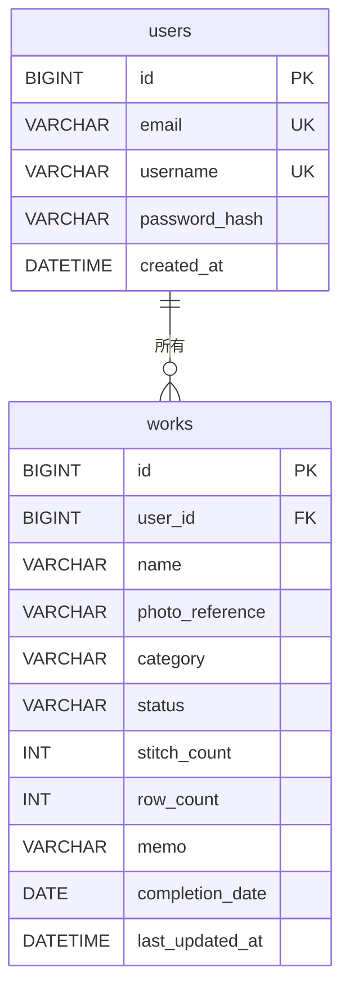

# Knitting データベース設計書

## 1. 文書情報

| 項目 | 内容 |
| --- | --- |
| 対象システム | Knitting |
| 文書種別 | データベース設計書 |
| 作成日 | 2026年9月7日 |
| 最終更新日 | 2026年9月26日 |
| 文書状態 | 初期版・レビュー済み・統合詳細設計書反映済み・今後更新予定 |
| 対象データベース | MySQL Community 8.4 LTS系列 |
| 対象範囲 | 初期版の `users` テーブル、`works` テーブル、および両者の関連 |
| 実装状況 | 本書に記載する初期版テーブル・制約・インデックスを実装・確認済み |
| 参照資料 | `README.md`、`01_requirements.md`、`02_basic-design.md`、`03_screen-design.md`、`05_detailed-design.md`、`DB仕様検討_users.docx`、`DB仕様検討_works.docx` |

> [!NOTE]
> 本書は、上位設計資料で定めたデータ要件とDB仕様検討資料で確定した初期版のデータ構造へ、統合詳細設計書で確定したDB・JPA・環境設定方針を反映したものです。公開環境に依存する事項は推測せず、後工程事項として分離します。

## 2. 本書の目的

本書は、Knittingの初期実装で永続化するユーザー情報と作品情報について、テーブル、カラム、データ型、キー、制約、関連、インデックスおよび画像・日時の扱いを定義するものです。

本書ではMySQL上の論理的・物理的なデータ構造を扱いますが、SQL実装コード、Javaクラス、JPAマッピング、接続設定等の詳細実装は扱いません。

## 3. データベース設計方針

- 初期版の業務データテーブルは `users` と `works` の2つだけとする。
- 1人のユーザーが複数作品を所有できる `users` 1 : N `works` の関係とする。
- 作品の基本情報と現在の制作情報は、初期版では1件の `works` レコードにまとめて保持する。
- 制作履歴、目数・段数の変更履歴、制作メモ履歴、完成日履歴は保持せず、現在値だけを保持する。
- データ整合性はアプリケーション側の入力チェックだけに依存せず、主キー、外部キー、NOT NULL、UNIQUE、DEFAULT、CHECK等のDB制約でも保護する。
- カテゴリーと制作ステータスはMySQLのENUM型を使用せず、`VARCHAR` で内部値を保持する。
- 作品画像の実ファイルはMySQLへ保存しない。開発環境ではファイル領域へ保存し、DBには参照情報だけを保持する。本番の物理保存先は公開環境決定後に確定する。
- インデックスは初期画面で使用する検索・並び順に必要な2件に限定し、実際のデータ量や性能を確認してから追加を検討する。
- 初期仕様にないテーブル、カラム、履歴、認証用データ構造は追加しない。
- 文字コードは `utf8mb4`、基本照合順序は `utf8mb4_0900_ai_ci` とする。
- DBスキーマの作成・変更履歴はFlyway migrationを正とし、Hibernateによる自動作成・更新は行わない。

## 4. 使用データベース

| 項目 | 内容 | 状態 |
| --- | --- | --- |
| データベース製品 | MySQL Community Edition | 決定 |
| MySQLバージョン | 8.4 LTS系列 | 決定。パッチバージョンは固定しない |
| 文字コード | `utf8mb4` | 決定 |
| 基本照合順序 | `utf8mb4_0900_ai_ci` | 決定 |
| DBスキーマ管理 | Flyway | 決定 |
| ORM／永続化 | Spring Data JPA／Hibernate | 決定 |
| DB接続設定 | 環境変数による外部設定 | 設計済み。実値は環境ごとに設定 |
| 開発・テスト・本番のDB | 同一のFlyway migrationを適用 | 決定。接続先は環境ごとに分離 |

永続データの正式な保存先にはMySQL Community 8.4 LTS系列を使用します。接続先・認証情報はソースコードへ記載せず外部設定とし、MySQL Connector/JはSpring Bootの依存関係管理に従います。本番の接続先、DBユーザー、権限等の実値は公開環境決定後に設定します。

### 4.1 スキーマ管理

- 初期スキーマはFlywayの `V1__create_initial_schema.sql` で作成する。
- 適用済みmigrationは書き換えず、変更時は新しいversionのmigrationを追加する。
- Flyway migrationをDB構造・制約・インデックスの正本とする。
- Hibernateは `ddl-auto=validate` でEntityとの整合性を確認し、`update`、`create`、`create-drop` は使用しない。
- `schema.sql`／`data.sql` によるスキーマ管理は使用しない。

## 5. 初期版テーブル一覧

| テーブル名 | 役割 | 主キー | 主な関連 |
| --- | --- | --- | --- |
| `users` | 登録ユーザーを一意に識別し、登録・ログイン・作品所有者の判定に必要な情報を保持する | `id` | `works.user_id` から参照される |
| `works` | ログインユーザーが登録した作品と、作品に紐づく現在の制作情報を保持する | `id` | `user_id` から `users.id` を参照する |

初期版で作成する業務データテーブルは上記2つのみです。

## 6. ER図

- 1人のユーザーは、作品を0件以上所有できます。
- 1つの作品は、必ず1人のユーザーに属します。
- ER図では型の種類を簡略表示しています。文字列長等の正確な定義は各テーブル設計を参照してください。

## 7. `users` テーブル設計

### 7.1 テーブル概要

| 項目 | 内容 |
| --- | --- |
| テーブル名 | `users` |
| 論理名 | ユーザー |
| 目的 | 登録ユーザーを識別し、ユーザー登録・ログイン・作品所有者判定に必要な情報を保持する |
| 主キー | `id` |
| カラム数 | 5 |

### 7.2 カラム定義

| カラム名 | 論理名 | MySQLデータ型 | NULL | PK | UNIQUE | AUTO_INCREMENT | 初期値・自動設定 | 説明 |
| --- | --- | --- | :---: | :---: | :---: | :---: | --- | --- |
| `id` | ユーザーID | `BIGINT` | 不可 | ○ | － | ○ | MySQLが自動採番 | ユーザーを一意に識別する内部ID。`works.user_id` から参照される |
| `email` | メールアドレス | `VARCHAR(255)` | 不可 | － | ○ | － | なし | 小文字へ正規化して保存し、重複を許可しない |
| `username` | ユーザー名 | `VARCHAR(20)` | 不可 | － | ○ | － | なし | 4～20文字の半角英数字。入力時の大文字・小文字表記を保持し、大文字・小文字を区別せず一意とする |
| `password_hash` | パスワードハッシュ | `VARCHAR(255)` | 不可 | － | － | － | なし | ハッシュ化済みの認証情報だけを保存する |
| `created_at` | ユーザー登録日時 | `DATETIME` | 不可 | － | － | － | Java側で登録完了時の現在日時を設定 | ユーザー登録が完了した日時を保持する |

### 7.3 カラム別仕様

#### `id`

- ユーザーを一意に識別する主キーとします。
- `BIGINT`、NOT NULL、PRIMARY KEY、AUTO_INCREMENTとします。
- 画面から入力・変更する値ではありません。
- `works.user_id` と同じデータ型を使用します。

#### `email`

- 必須とし、NULLおよび重複を許可しません。
- 登録時にメールアドレス全体を小文字へ変換して保存します。
- 例えば `Mame@Example.com` は `mame@example.com` として保存します。
- 大文字・小文字だけが異なる入力は同一メールアドレスとして扱います。
- メールアドレス形式の検証と小文字への正規化は、アプリケーション側でも行います。
- 初期版ではログインIDとして使用しません。

#### `username`

- 必須、4文字以上20文字以下の半角英数字とします。
- 重複を許可せず、重複判定とログイン時の照合では大文字・小文字を区別しません。
- 表示用として、登録時に入力された大文字・小文字の表記を保持します。
- 例えば `Mame123` が登録済みの場合、`mame123` や `MAME123` は登録できません。
- `utf8mb4_0900_ai_ci` の照合規則とUNIQUE制約により、大文字・小文字を区別しない一意性をDB側でも保証します。

#### `password_hash`

- ユーザーが入力した平文パスワードは保存しません。
- DBにはハッシュ化済みの認証情報だけを保存します。
- 入力パスワードは8文字以上64文字以下とし、Spring Security側でハッシュ化した値を保存します。
- 確認用パスワードは一致確認にのみ使用し、DBへ保存しません。

#### `created_at`

- ユーザー登録が完了した日時を保持します。
- 初期版の `users` では登録日時として `created_at` を保持します。
- Java側で登録完了時の現在日時を設定します。
- 初期版では `users.updated_at` を設けません。

## 8. `works` テーブル設計

### 8.1 テーブル概要

| 項目 | 内容 |
| --- | --- |
| テーブル名 | `works` |
| 論理名 | 作品 |
| 目的 | 作品の基本情報と、作品に紐づく現在の制作情報を保持する |
| 主キー | `id` |
| 外部キー | `user_id` → `users.id` |
| カラム数 | 11 |

### 8.2 カラム定義

| カラム名 | 論理名 | MySQLデータ型 | NULL | PK | FK | AUTO_INCREMENT | 初期値・自動設定 | CHECK等の制約 | 説明 |
| --- | --- | --- | :---: | :---: | --- | :---: | --- | --- | --- |
| `id` | 作品ID | `BIGINT` | 不可 | ○ | － | ○ | MySQLが自動採番 | － | 作品を一意に識別する内部ID |
| `user_id` | ユーザーID／作品所有者 | `BIGINT` | 不可 | － | `users.id` | － | なし | 外部キー | 作品を所有するユーザーを示す |
| `name` | 作品名 | `VARCHAR(50)` | 不可 | － | － | － | なし | UNIQUEなし | 1～50文字。同一ユーザー内で重複可 |
| `photo_reference` | 作品写真参照情報 | `VARCHAR(500)` | 可 | － | － | － | 写真なしは `NULL` | － | ローカル保存した画像ファイルへの参照情報 |
| `category` | カテゴリー | `VARCHAR(20)` | 不可 | － | － | － | なし | 許可された8内部値のみ | 画面表示名ではなく内部値を保存する |
| `status` | 制作ステータス | `VARCHAR(20)` | 不可 | － | － | － | DB DEFAULTなし。画面初期値は `IN_PROGRESS` とし、登録時はユーザーの選択値をJava側で設定 | `IN_PROGRESS`／`COMPLETED` のみ | 制作中・完成を内部値で保持する |
| `stitch_count` | 現在の目数 | `INT` | 不可 | － | － | － | `0` | `0`～`9999` | 作品専用目数カウンターの現在値 |
| `row_count` | 現在の段数 | `INT` | 不可 | － | － | － | `0` | `0`～`9999` | 作品専用段数カウンターの現在値 |
| `memo` | 制作メモ | `VARCHAR(1000)` | 不可 | － | － | － | 空文字 | 最大1000文字 | 1作品につき現在のメモを1つ保持する |
| `completion_date` | 完成日 | `DATE` | 可 | － | － | － | 制作中は `NULL`。完成時は登録日または変更日 | `status` との整合性を保持 | 年月日だけを保持し、時刻は持たない |
| `last_updated_at` | 最終更新日時 | `DATETIME` | 不可 | － | － | － | Java側で新規登録時の現在日時を設定 | － | 制作中一覧等の並び順に使用する |

### 8.3 カラム別仕様

#### `id`

- 作品を一意に識別する主キーとします。
- `BIGINT`、NOT NULL、PRIMARY KEY、AUTO_INCREMENTとします。
- 画面から入力・変更する値ではありません。

#### `user_id`

- 作品の所有者を示す値とし、`users.id` を参照します。
- `users.id` と同じ `BIGINT`、NOT NULLとします。
- 1つの作品は必ず1人のユーザーに属します。
- 外部キーにはON DELETE CASCADEを設定せず、参照中のユーザー削除を制限する方針とします。ユーザー退会・削除機能自体は将来検討事項です。

#### `name`

- 必須とし、1文字以上50文字以下とします。
- 日本語を含む自由な文字列を保存できます。
- 同一ユーザー内で同じ作品名を複数登録できるため、UNIQUE制約を付けません。

#### `photo_reference`

- 作品写真は任意で、1作品につき1枚とします。
- 画像ファイル本体はローカルファイルとして保存し、DBには参照情報だけを保存します。
- 写真未登録または写真削除後は `NULL` とします。
- `photo_reference` が `NULL` の場合は、画面側でKnitting共通の初期画像を表示します。
- 共通初期画像の参照先を各 `works` レコードへ重複保存しません。
- 参照情報は先頭スラッシュを付けない相対キー `works/<UUID>.jpg` または `works/<UUID>.png` とし、保存ルートの絶対パスはDBへ保存しません。

#### `category`

- 必須とし、画面表示用の日本語ではなく、8種類の内部値のいずれかを保存します。
- データ型は `VARCHAR(20)` とし、MySQLのENUM型は使用しません。
- 初期版ではカテゴリー用の別テーブルを作成しません。
- Java側ではカテゴリーをEnumとして扱い、内部値を文字列でDBへ保存します。

#### `status`

- 必須とし、`IN_PROGRESS` または `COMPLETED` を保存します。
- データ型は `VARCHAR(20)` とし、MySQLのENUM型は使用しません。
- 作品登録画面の初期選択は `IN_PROGRESS` です。
- `status` にはDB DEFAULTを設定しません。画面の初期表示は `IN_PROGRESS` ですが、登録時にはユーザーが選択した値をJava側で必ず設定します。
- Java側では制作ステータスをEnumとして扱い、内部値を文字列でDBへ保存します。

#### `stitch_count`／`row_count`

- 作品専用カウンターの現在値として、どちらも `INT` で保持します。
- NOT NULL、DEFAULT `0` とします。
- 許可範囲は0～9999の整数とします。
- アプリケーション側のバリデーションに加えて、DB側にも範囲を守るCHECK制約を設定します。

#### `memo`

- 1作品につき現在の制作メモを1つ保持します。
- データ型は `VARCHAR(1000)` とし、最大1000文字とします。
- 任意入力ですがDB上ではNULLを使用せず、NOT NULLとします。
- 未入力時は空文字を保存し、DEFAULTも空文字とします。
- 初期版では `TEXT` 型を採用しません。

#### `completion_date`

- `DATE` で年月日だけを保持し、時刻は保持しません。
- `IN_PROGRESS` の場合は `NULL`、`COMPLETED` の場合は日付を保持します。
- 登録時から完成の場合は、登録日を初期値とします。
- 制作中から完成へ変更した場合は、変更日を初期値とします。
- 完成日は後から任意の日付へ変更できますが、未来日は許可しません。
- 完成から制作中へ戻した場合は `NULL` とし、以前の完成日を現在の完成日として使用しません。
- 再度完成へ変更した場合は、再完成日を新しい初期値とします。
- 過去の完成日履歴は保持しません。
- 未来日の禁止は現在日付に依存するため、複雑なDB制約を追加せず、アプリケーション側で検証します。

#### `last_updated_at`

- 新規作品登録時に現在日時を設定します。
- 次の変更操作を行った場合に更新します。
  - 目数変更
  - 段数変更
  - 制作メモ変更
  - 作品名変更
  - 写真変更
  - 写真削除
  - カテゴリー変更
  - 制作ステータス変更
- 作品詳細画面を閲覧しただけでは更新しません。
- 完成日の手動変更だけでは、現行仕様上 `last_updated_at` を更新しません。
- Java側で `Asia/Tokyo` を基準とする現在日時を設定し、値が実際に変更された場合だけ更新します。

### 8.4 `works` に `created_at` を設けない理由

初期版では、作品登録日時を表示、検索、並び替え、集計に使用する要件がありません。そのため、`works` には `created_at` を設けません。

作品に関する日時情報は、完成日を示す `completion_date` と、指定された変更操作の日時を示す `last_updated_at` の2項目だけを保持します。将来、作品登録日時が必要になった場合に `created_at` の追加を検討します。

## 9. リレーション設計

| 親テーブル | 親カラム | 子テーブル | 子カラム | 関係 | 子側NULL | 削除時の動作 |
| --- | --- | --- | --- | --- | --- | --- |
| `users` | `id` | `works` | `user_id` | 1 : N | 不可 | ON DELETE CASCADEなし。参照中のユーザー削除を制限 |

- `users.id` と `works.user_id` は、対応する `BIGINT` を使用します。
- 外部キーによって、存在しないユーザーへ作品を紐づけないようにします。
- アプリケーションでは、ログインユーザー本人の `works` だけを閲覧・変更・削除できるようにします。
- ユーザー削除機能は初期実装の対象外です。外部キーにはON DELETE CASCADEを設定しません。

## 10. 内部値・コード値

### 10.1 カテゴリー

`works.category` には次の内部値を保存します。

| 内部値 | 画面表示 |
| --- | --- |
| `HAT` | 帽子 |
| `TOP` | 上衣 |
| `BOTTOM` | 下衣 |
| `SCARF` | マフラー |
| `BAG` | バッグ |
| `TOY` | ぬいぐるみ |
| `SMALL_GOODS` | 小物 |
| `OTHER` | その他 |

内部値と表示名を分離し、画面表示文言が変わってもDB内の値を変更せずに済む構成とします。

### 10.2 制作ステータス

`works.status` には次の内部値を保存します。

| 内部値 | 画面表示 |
| --- | --- |
| `IN_PROGRESS` | 制作中 |
| `COMPLETED` | 完成 |

Java側ではカテゴリー・制作ステータスをEnumとして扱い、DBには上記内部値を文字列で保存します。

## 11. NULL・初期値の方針

### 11.1 `users`

| カラム | NULL | 初期値・自動設定の方針 |
| --- | --- | --- |
| `id` | 不可 | AUTO_INCREMENTで自動採番 |
| `email` | 不可 | 初期値なし。小文字へ正規化した入力値を保存 |
| `username` | 不可 | 初期値なし。入力時の表記を保持 |
| `password_hash` | 不可 | 初期値なし。ハッシュ化済み情報を保存 |
| `created_at` | 不可 | Java側で登録完了時の現在日時を設定 |

### 11.2 `works`

| カラム | NULL | 初期値・自動設定の方針 |
| --- | --- | --- |
| `id` | 不可 | AUTO_INCREMENTで自動採番 |
| `user_id` | 不可 | ログイン中の所有者を設定 |
| `name` | 不可 | 初期値なし |
| `photo_reference` | 可 | 写真未登録時は `NULL` |
| `category` | 不可 | 初期値なし。ユーザーが選択した内部値を設定 |
| `status` | 不可 | DB DEFAULTなし。画面初期値は `IN_PROGRESS`、登録時はユーザーが選択した値をJava側で設定 |
| `stitch_count` | 不可 | DEFAULT `0` |
| `row_count` | 不可 | DEFAULT `0` |
| `memo` | 不可 | DEFAULT 空文字 |
| `completion_date` | 可 | `IN_PROGRESS` は `NULL`。`COMPLETED` は登録日または完成への変更日 |
| `last_updated_at` | 不可 | Java側で新規登録時の現在日時を設定 |

任意入力であっても、「値が存在しない状態」と「空の文字列」を区別する必要がない制作メモにはNULLを使用しません。一方、写真未登録と制作中作品の完成日は値が存在しない状態を表すためNULLを使用します。

## 12. DB制約

### 12.1 `users` の制約

| 対象 | 制約 | 方針 |
| --- | --- | --- |
| `id` | PRIMARY KEY／NOT NULL／AUTO_INCREMENT | ユーザーを一意に識別し、MySQLで自動採番する |
| `email` | NOT NULL／UNIQUE（`uq_users_email`） | 小文字へ正規化したメールアドレスの重複を防ぐ |
| `username` | NOT NULL／UNIQUE（`uq_users_username`） | `utf8mb4_0900_ai_ci` により大文字・小文字を区別せず重複を防ぐ |
| `password_hash` | NOT NULL | 平文ではなくハッシュ化済み情報を必須とする |
| `created_at` | NOT NULL | 登録日時を必須とする |

メール形式、ユーザー名の4～20文字・半角英数字、元パスワードの8～64文字等の入力要件は、アプリケーション側でも検証します。DBへ追加する具体的なCHECKの有無や式は、DB仕様検討資料で確定している範囲を超えるため本書では決定しません。

### 12.2 `works` の制約

| 対象 | 制約 | 方針 |
| --- | --- | --- |
| `id` | PRIMARY KEY／NOT NULL／AUTO_INCREMENT | 作品を一意に識別し、MySQLで自動採番する |
| `user_id` | FOREIGN KEY（`fk_works_user`）／NOT NULL | `users.id` に存在するユーザーへ必ず紐づける。ON DELETE CASCADEは設定しない |
| `name` | NOT NULL | 作品名を必須とする。重複を許可するためUNIQUEは付けない |
| `photo_reference` | NULL可 | 写真未登録・削除後を `NULL` で表す |
| `category` | NOT NULL／CHECK（`chk_works_category`） | 8種類の内部値以外を許可しない |
| `status` | NOT NULL／CHECK（`chk_works_status`） | `IN_PROGRESS` と `COMPLETED` 以外を許可しない。DB DEFAULTは設定しない |
| `stitch_count` | NOT NULL／DEFAULT `0`／CHECK（`chk_works_stitch_count`） | 0～9999の整数だけを許可する |
| `row_count` | NOT NULL／DEFAULT `0`／CHECK（`chk_works_row_count`） | 0～9999の整数だけを許可する |
| `memo` | NOT NULL／DEFAULT 空文字 | NULLを使用せず、未入力を空文字で表す |
| `completion_date` | NULL可／CHECK（`chk_works_status_completion_date`） | `status` と日付の有無を一致させる |
| `last_updated_at` | NOT NULL | 新規登録時と指定された変更時に日時を保持する |

### 12.3 許可値と範囲

| 対象 | DB側で許可する値・条件 |
| --- | --- |
| `category` | `HAT`、`TOP`、`BOTTOM`、`SCARF`、`BAG`、`TOY`、`SMALL_GOODS`、`OTHER` のいずれか |
| `status` | `IN_PROGRESS`、`COMPLETED` のいずれか |
| `stitch_count` | 0以上9999以下 |
| `row_count` | 0以上9999以下 |
| `status` と `completion_date` | `IN_PROGRESS` の場合は `completion_date IS NULL`、`COMPLETED` の場合は `completion_date IS NOT NULL` |

具体的なDDLはFlyway migrationで管理します。完成日の未来日禁止はDB制約に含めず、アプリケーション側のバリデーションで実現します。

## 13. インデックス設計

初期版では、作品一覧の主要な取得条件と同一日時の安定した並び順に合わせて、次の2つの複合インデックスを設けます。

| インデックス名 | 対象テーブル | 構成カラム（左から順） | 用途 |
| --- | --- | --- | --- |
| `idx_works_user_status_updated` | `works` | `user_id`, `status`, `last_updated_at DESC`, `id DESC` | ログインユーザー本人の制作中作品を、最終更新日時が新しい順に取得する |
| `idx_works_user_status_completed` | `works` | `user_id`, `status`, `completion_date DESC`, `id DESC` | ログインユーザー本人の完成作品を、完成日が新しい順に取得する |

- カテゴリー絞り込みは、初期版では通常の検索条件として実行します。
- カテゴリー専用インデックス、およびカテゴリーを含む追加複合インデックスは初期版では作成しません。
- 実際のデータ量や実行計画を確認し、カテゴリー絞り込みが性能上の問題になった場合に追加を検討します。
- インデックス追加には登録・更新時の負担と管理コストが伴うため、必要性を確認して判断します。

将来の候補は、次のとおりです。初期版では作成しません。

- `user_id`, `status`, `category`, `last_updated_at`
- `user_id`, `status`, `category`, `completion_date`

## 14. 画像データの扱い

### 14.1 初期版の保存方針

- 作品画像の実ファイルはMySQLへ保存しません。
- 開発環境では画像ファイルをローカルファイルとして保存します。本番の物理ストレージは公開環境決定後に確定します。
- `works.photo_reference` には、画像ファイルへの参照情報だけを保存します。
- 参照情報は `works/<UUID>.jpg` または `works/<UUID>.png` の形式とし、保存ルートの絶対パスやブラウザー向けURLは保存しません。
- 写真が登録されていない場合、または登録写真を削除した場合は `photo_reference` を `NULL` とします。
- `photo_reference` が `NULL` の作品には、画面側でKnitting共通の初期画像を表示します。
- 初期画像そのものの参照先は各作品レコードへ保存しません。
- 対応形式はJPEG／PNG、入力上限は10 MiB、画像寸法は幅・高さとも8192px以下とします。保存時は長辺1920pxを上限として必要に応じて縮小し、メタデータを除去します。

### 14.2 公開環境決定後・将来拡張時の事項

- 本番環境の物理保存先、永続ディスクまたはObject Storageの選択
- 本番環境の保存容量、バックアップ、認証情報管理
- Reverse Proxy等を含むアップロード上限の設定

公開運用上必要になった場合のクラウドストレージへの移行は、将来検討事項とします。

## 15. 日付・日時の扱い

| 対象 | 型 | 粒度 | 設定・更新条件 | 補足 |
| --- | --- | --- | --- | --- |
| `users.created_at` | `DATETIME` | 年月日・時刻 | Java側でユーザー登録完了時に設定 | `Asia/Tokyo` 基準 |
| `works.completion_date` | `DATE` | 年月日 | 完成登録時、制作中から完成への変更時、ユーザーによる手動変更時 | 制作中は `NULL`。未来日はアプリケーション側で禁止 |
| `works.last_updated_at` | `DATETIME` | 年月日・時刻 | Java側で新規作品登録時、および本書で定めた変更操作時に設定 | `Asia/Tokyo` 基準。閲覧だけでは更新せず、完成日の手動変更だけでも更新しない |

- 初期版では過去の完成日履歴を保持しません。
- 完成から制作中へ戻す場合は `completion_date` を `NULL` にします。
- 再完成時は再完成日を新しい `completion_date` の初期値とします。
- アプリケーションの日時基準は `Asia/Tokyo` とし、Java側では注入したClockを通じて現在日付・日時を取得します。
- `DEFAULT CURRENT_TIMESTAMP` および `ON UPDATE CURRENT_TIMESTAMP` には依存しません。
- `works` には作品登録日時を表す `created_at` を設けません。

## 16. データ削除・整合性に関する方針

### 16.1 作品削除

- 作品削除の画面要件では、対象作品と紐づく目数、段数、制作メモ等を削除し、復元できないものとします。
- 作品基本情報と現在の制作情報は同じ `works` レコードに保持します。
- 作品削除では、所有者確認後に対象レコードを削除し、コミット後にアップロード画像を削除します。画像削除失敗時はDB削除を取り消さず、ログへ記録して後続の清掃対象とします。
- 初期版のテーブルへ削除履歴用のカラムや別テーブルは追加しません。

### 16.2 ユーザー削除

- ユーザー退会・削除機能は初期実装の対象外です。
- 初期版の外部キーにON DELETE CASCADEは設定せず、参照中のユーザー削除を制限します。
- 将来ユーザー退会・削除機能を追加する場合の作品の削除・保持・移管方針は、その機能の設計時に決定します。

### 16.3 その他の整合性

- 存在しない `users.id` を `works.user_id` へ設定できないよう、外部キーで保護します。
- `status` と `completion_date` の組み合わせはDB側のCHECK制約でも保護します。
- `category`、`status`、カウンター範囲は、アプリケーション側とDB側の両方で検証します。
- 自動保存時は悲観的ロックと更新前値の照合により競合を検出します。競合時は更新せず、利用者へ再読み込みを案内します。

## 17. 初期版でDB管理しない情報

| 情報 | 初期版の扱い |
| --- | --- |
| 簡易カウンターの目数・段数 | 作品専用カウンターとは別機能。ブラウザーのlocalStorageで保持し、専用テーブルは追加しない |
| 毛糸・推奨針号数対応表 | アプリケーション内の毛糸基準データとして保持し、専用テーブルは追加しない |
| 自動ログイン情報 | Spring SecurityのトークンベースRemember-Meを使用する。Persistent Token Repository方式は採用せず、永続トークン用テーブルは追加しない |
| 作品画像ファイル本体 | ローカルファイルとして保存し、MySQLには `photo_reference` だけを保存する |
| 共通初期画像の参照先 | `photo_reference` が `NULL` の場合に画面側で使用し、各作品レコードへ保存しない |
| 確認用パスワード | 登録時の一致確認にだけ使用し、保存しない |
| 平文パスワード | 保存せず、`password_hash` だけを保存する |
| カテゴリー・ステータスのマスターデータ | 初期版では別テーブルを作成せず、許可された内部値を `works` に保存する |
| 作品登録日時 | 現行要件で使用しないため、`works.created_at` を設けない |
| 過去の完成日・制作情報の履歴 | 初期版では履歴を保持せず、現在値だけを保存する |

## 18. 今後の検討事項

| No. | 検討事項 | 決定予定工程 |
| ---: | --- | --- |
| 1 | 本番DBの接続先、DBユーザー・権限、Secret Manager等の実値 | 公開環境決定後 |
| 2 | 本番画像ストレージ、保存容量、バックアップ | 公開環境決定後 |
| 3 | 将来のクラウドストレージ移行 | 将来拡張時 |
| 4 | ユーザー退会・削除機能と、所有作品の削除・保持・移管方針 | 将来拡張時 |
| 5 | `users.updated_at` の追加 | ユーザー情報変更機能の設計時 |
| 6 | `works.created_at` の追加 | 作品登録日時を使用する要件が生じた時 |
| 7 | カテゴリー絞り込み性能に応じた追加複合インデックス | 性能確認後 |
| 8 | ユーザー情報変更・パスワード再設定に伴うデータ構造 | 将来拡張時 |

## 19. 本書の対象外とする実装事項

次の事項はデータベース物理設計そのものではないため、本書では詳述しません。確定済みの事項は `05_detailed-design.md` を参照し、公開環境依存の実値は環境決定後に設定します。

- Javaクラス名、パッケージ構成、メソッド名
- Entityクラスの構成・コードと具体的なJPAマッピング
- Repository、Service、Controllerの構成
- URLパス
- CREATE TABLE等のSQL実装コード
- JDBCドライバ、JDBC接続設定
- `application.properties` 等の設定内容
- DBユーザー、権限、接続先の実値、環境別の物理構成
- Spring Securityの具体的な設定
- Spring Security、Remember-Me、自動保存APIの具体的なWeb実装
- 画像アップロード・削除処理の実装コード
- HTML、CSS、JavaScriptの具体的な実装

本書に残る公開環境依存事項および将来拡張事項は、該当工程で決定した時点で関連資料とともに更新します。
